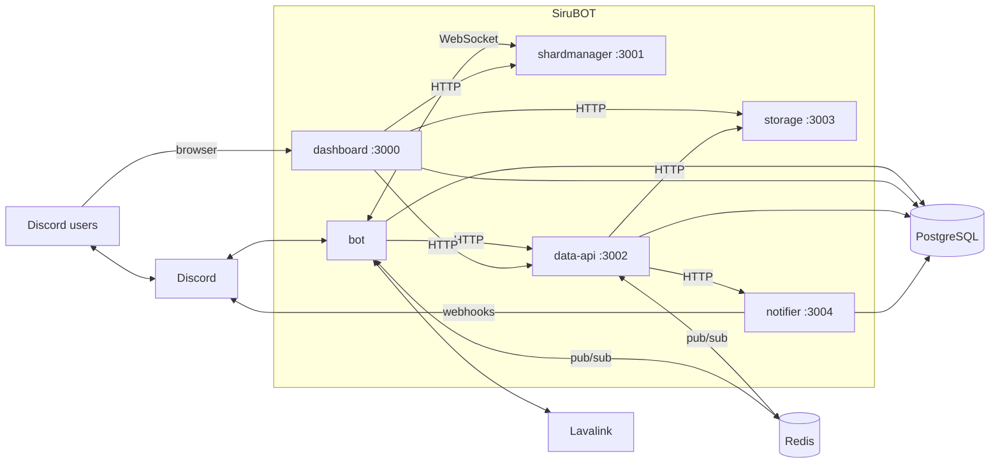

<h1 align="center">SiruBOT</h1>

<p align="center">
  디스코드 음악 봇 플랫폼입니다. Lavalink 재생, 웹 대시보드, 그 뒤의 서비스들이 하나의 모노레포에 들어 있습니다.
</p>

<p align="center">
  <a href="https://github.com/mochilabs/SiruBOT/releases"></a>
  
  <a href="LICENSE"></a>
  <a href="https://github.com/mochilabs/SiruBOT/actions/workflows/lint.yml"></a>
  <a href="https://github.com/mochilabs/SiruBOT/actions/workflows/docker-publish.yml"></a>
</p>

<p align="center">
  <a href="README.md">English</a> | <b>한국어</b>
</p>

## 목차

- [기능](#기능)
- [아키텍처](#아키텍처)
- [빠른 시작](#빠른-시작)
- [환경 설정](#환경-설정)
- [스크립트](#스크립트)
- [배포](#배포)
- [문서](#문서)
- [기여](#기여)
- [보안](#보안)
- [라이선스](#라이선스)

## 기능

- **음악 재생**: Lavalink 기반으로 대기열, 반복, 셔플, 탐색, 특정 곡으로 이동, 슬래시 명령어 검색 자동 완성, SponsorBlock 건너뛰기, 챕터, 싱크 가사를 지원합니다.
- **웹 대시보드** (Next.js): 실시간 플레이어 제어, 서버 설정, 플레이리스트, 통계, 커스텀 명령어, 티켓, 소셜 알림, 샤드 상태를 다룹니다.
- **플레이리스트와 프로필**: 디스코드나 대시보드에서 관리하는 개인 플레이리스트와, 청취 통계를 담은 프로필 카드 이미지를 제공합니다.
- **소셜 알림**: YouTube, Twitch, 치지직 방송 알림을 디스코드 웹훅으로 보냅니다.
- **부가 기능**: AI 채팅, TTS, 임시 음성 채널, 날씨, 운세, 택배 조회.
- **확장 구조**: 샤드 매니저가 봇 프로세스에 샤드를 배정하므로, 중단 없이 봇을 늘리거나 교체할 수 있습니다.

## 아키텍처

독립 프로세스 6개와 공용 패키지 4개로 이루어져 있습니다. 앱끼리는 서로 import하지 않고, Redis pub/sub, 인증된 HTTP, 샤드 매니저의 WebSocket 프로토콜로만 통신합니다.



| 워크스페이스 | 역할 | 스택 |
|---|---|---|
| `apps/bot` | 디스코드 게이트웨이, 슬래시 명령어, 오디오, AI 채팅, TTS, 티켓 | Sapphire (discord.js), lavalink-client |
| `apps/dashboard` | 서버 관리 웹 앱 | Next.js App Router, React 19 |
| `apps/data-api` | 게이트웨이: 외부 API 캐시, Redis 허브, 이미지 렌더링, 예약 LLM 작업 | Fastify 5 |
| `apps/shardmanager` | 샤드 배정과 상태 집계 | Fastify 5, WebSocket |
| `apps/storage` | 생성 이미지와 티켓 기록을 보관하는 오브젝트 스토리지 | Fastify 5 |
| `apps/notifier` | 방송 알림을 디스코드 웹훅으로 전달 | Fastify 5 |
| `packages/prisma` | PostgreSQL 스키마와 클라이언트 | Prisma 7 |
| `packages/utils` | Redis 채널 계약, zod 스키마, 공용 헬퍼 | zod |
| `packages/app-kit` | 공용 Fastify 인증, env 검증, 로거 | Fastify |
| `packages/shardclient` | 샤드 매니저용 WebSocket 클라이언트 | ws |

대시보드는 봇과 직접 통신하지 않습니다. 요청은 대시보드 → data-api → Redis → 해당 서버를 맡은 봇 순서로 전달됩니다. Redis 채널 맵과 부팅/종료 순서를 포함한 전체 구조는 [docs/architecture.md](docs/architecture.md)에 있습니다.

## 빠른 시작

### 준비물

- Node.js 22 이상, 그리고 Yarn 4.12를 위한 Corepack 활성화 (`corepack enable`)
- PostgreSQL과 Redis
- [Lavalink](https://lavalink.dev) v4 노드
- 봇 토큰이 있는 디스코드 애플리케이션

### 로컬 실행

```bash
git clone https://github.com/mochilabs/SiruBOT.git
cd SiruBOT
yarn install

# Prisma 클라이언트를 생성합니다. 타입 검사나 빌드 전에 반드시 필요합니다.
yarn generate

# 앱마다 env 파일을 만든 뒤 값을 채웁니다 (환경 설정 참고).
for app in bot dashboard data-api shardmanager storage notifier; do
  cp -n "apps/$app/.env.example" "apps/$app/.env"
done

# 데이터베이스 마이그레이션을 적용합니다.
yarn workspace @sirubot/prisma migrate:dev
```

그다음 필요한 것만 실행합니다.

```bash
# 대시보드 개발 서버 (http://localhost:3000)
yarn dev

# 백엔드 앱과 패키지를 변경 시 다시 빌드 (실행하지는 않음)
yarn watch

# 다른 터미널에서 백엔드 앱 실행
yarn workspace @sirubot/bot start
```

음악 재생은 봇만 있어도 됩니다. 대시보드의 실시간 기능과 날씨, 가사 같은 명령어에는 `data-api`가 필요하고, `shardmanager`, `storage`, `notifier`는 각자 담당하는 기능을 쓸 때만 필요합니다. 단계별 온보딩은 [docs/setup-dev.md](docs/setup-dev.md)에 있습니다.

## 환경 설정

각 앱은 자신의 `apps/<앱>/.env`를 읽습니다. 같은 폴더의 `.env.example`에 모든 변수가 있고, 아래 표는 로컬 개발에 필요한 최소 구성입니다.

| 앱 | 최소 변수 |
|---|---|
| `bot` | `DISCORD_TOKEN`, `DATABASE_URL`, `REDIS_URL`, `LAVALINK_HOSTS` |
| `dashboard` | `DATABASE_URL`, `DISCORD_CLIENT_ID`, `DISCORD_CLIENT_SECRET`, `AUTH_SECRET`, `NEXT_PUBLIC_APP_URL` |
| `data-api` | `DATA_API_AUTH_KEY` (또는 `AUTH_KEY`) |
| `shardmanager` | `DISCORD_TOKEN`, `AUTH_KEY` |
| `storage` | `STORAGE_AUTH_KEY` (또는 `AUTH_KEY`), `STORAGE_PUBLIC_URL` |
| `notifier` | `NOTIFIER_AUTH_KEY` (또는 `AUTH_KEY`), `DATABASE_URL` |

자주 틀리는 부분:

- **공유 키.** `bot`, `dashboard`, `data-api`는 같은 `DATA_API_AUTH_KEY`(또는 `AUTH_KEY`)를 써야 하고, 봇과 대시보드에는 `DATA_API_URL`(기본 포트 3002)이 필요합니다. 키가 없으면 대시보드가 data-api 호출을 건너뛰어 플레이어, 채널, 역할 기능이 실패합니다.
- **헤더 형식.** 서비스 간 요청은 `Authorization`에 키 원문을 그대로 보냅니다. `Bearer` 접두사는 붙이지 않습니다.
- **`LAVALINK_HOSTS`** 는 `id_host_port[_password]`를 쉼표로 이은 목록입니다. 예: `main_localhost_2333_youshallnotpass`.
- **슬래시 명령어**는 `REGISTER_COMMANDS=true`일 때만 시작 시 등록됩니다. 수동 동기화: `yarn dlx tsx scripts/register-commands.ts --dry-run`.
- **단독 실행.** 개발 환경에서는 `SHARD_MANAGER_URL`을 비워 두면 샤드 매니저 없이 봇 프로세스 하나만 실행합니다. 프로덕션에서는 필수입니다.

전체 환경 변수 표는 [docs/architecture.md](docs/architecture.md#10-environment-variables)에 있습니다.

## 스크립트

저장소 루트에서 실행하면 Turborepo가 각 워크스페이스로 나눠 실행합니다.

| 명령어 | 하는 일 |
|---|---|
| `yarn generate` | Prisma 클라이언트 생성 |
| `yarn dev` | 대시보드 개발 서버 실행 |
| `yarn watch` | 백엔드 앱과 패키지를 변경 시 다시 빌드 |
| `yarn build` | 전체 프로덕션 빌드 |
| `yarn typecheck` | 의존성을 먼저 빌드한 뒤 타입 검사 |
| `yarn lint` / `yarn lint:fix` | Prettier 검사 (대시보드는 ESLint) |
| `yarn test` | Vitest 테스트 실행 |

워크스페이스 하나만 대상으로 할 때는 필터나 워크스페이스 명령을 씁니다.

```bash
yarn turbo build --filter=@sirubot/utils
yarn workspace @sirubot/bot test src/path/file.test.ts
```

## 배포

루트 `Dockerfile`에는 앱마다 빌드 타깃이 하나씩 있습니다.

```bash
docker build --target bot -t sirubot-bot .
# 다른 타깃: dashboard, shardmanager, data-api, storage, notifier
```

미리 빌드된 이미지는 GitHub Container Registry에 `ghcr.io/mochilabs/sirubot-<앱>`으로 올라갑니다.

| 태그 | 빌드 기준 | 워크플로 |
|---|---|---|
| 릴리스 버전 (`5.2.12`, `5.2`) | GitHub 릴리스 | `docker-publish.yml` |
| `beta`, `beta-<sha>` | `beta` 브랜치 푸시 | `docker-beta.yml` |
| `<브랜치>`, `<브랜치>-<sha>` | `docker-build` 라벨이 붙은 PR | `docker-branch.yml` |

`docker/`에는 로컬용 Compose 예시(Lavalink만 켜져 있고 나머지 서비스는 주석 처리)와, 앱과 인프라용 Swarm 스택 파일이 있습니다. 앱을 시작하기 전에 PostgreSQL, Redis, Lavalink에 연결할 수 있어야 하며, 봇 이미지는 시작할 때 Prisma 마이그레이션을 적용합니다. 롤링 업데이트, 헬스체크, 장애 대응은 [docs/runbook-production.md](docs/runbook-production.md)에서 다룹니다.

## 문서

| 문서 | 내용 |
|---|---|
| [docs/architecture.md](docs/architecture.md) | 시스템 컨텍스트, 앱별 상세, 공유 계약, 런타임 흐름 |
| [docs/setup-dev.md](docs/setup-dev.md) | 로컬 설정, 포트, 검증 명령 |
| [docs/runbook-production.md](docs/runbook-production.md) | 빌드, 배포, 샤드 장애 대응, 종료 순서 |
| [docs/api-data-api.md](docs/api-data-api.md) | data-api 엔드포인트, 인증, 캐시 TTL, 스케줄러 |
| [docs/api-dashboard.md](docs/api-dashboard.md) | 대시보드 API 라우트, 권한, rate limit |
| [docs/3rdparty.md](docs/3rdparty.md) | Lavalink 플러그인과 외부 서비스 |
| [docs/README.md](docs/README.md) | 문서 목록과 작성 규칙 |
| [AGENTS.md](AGENTS.md) | 코딩 에이전트와 기여자를 위한 규칙 |

## 기여

1. `beta`에서 브랜치를 만듭니다. `main`은 배포 스냅샷이라 직접 작업하지 않습니다.
2. 변경한 뒤 `yarn lint`, `yarn typecheck`, `yarn test`를 실행합니다.
3. `beta`를 대상으로 PR을 엽니다. [docs/pr-message-rule.md](docs/pr-message-rule.md)에 따라 검증한 것과 검증하지 못한 것을 적고, UI 변경에는 스크린샷을 첨부합니다.

## 보안

취약점은 공개 이슈가 아니라 [SECURITY.md](SECURITY.md)에 안내된 방법으로 비공개 제보해 주세요.

## 라이선스

[MIT](LICENSE) © SiruBOT Contributors
