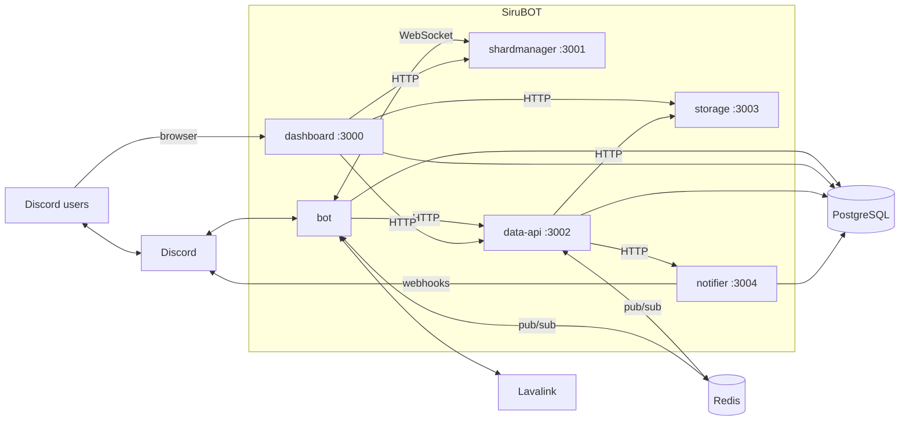

<h1 align="center">SiruBOT</h1>

<p align="center">
  A Discord music bot platform: Lavalink playback, a web dashboard, and the services behind them, in one monorepo.
</p>

<p align="center">
  <a href="https://github.com/mochilabs/SiruBOT/releases"></a>
  
  <a href="LICENSE"></a>
  <a href="https://github.com/mochilabs/SiruBOT/actions/workflows/lint.yml"></a>
  <a href="https://github.com/mochilabs/SiruBOT/actions/workflows/docker-publish.yml"></a>
</p>

<p align="center">
  <b>English</b> | <a href="README.ko.md">한국어</a>
</p>

## Contents

- [Features](#features)
- [Architecture](#architecture)
- [Quick start](#quick-start)
- [Configuration](#configuration)
- [Scripts](#scripts)
- [Deployment](#deployment)
- [Documentation](#documentation)
- [Contributing](#contributing)
- [Security](#security)
- [License](#license)

## Features

- **Music playback** through Lavalink: queue, loop, shuffle, seek, jump to track, search autocomplete in slash commands, SponsorBlock skipping, chapters and synced lyrics.
- **Web dashboard** (Next.js): live player control, guild settings, playlists, statistics, custom commands, tickets, social alerts and shard status.
- **Playlists and profiles**: personal playlists managed from Discord or the dashboard, and a rendered profile card with listening stats.
- **Social alerts**: YouTube, Twitch and Chzzk live notifications delivered through Discord webhooks.
- **Extras**: AI chat, TTS, temporary voice channels, weather, horoscope and parcel tracking.
- **Built to scale**: a shard manager assigns shards to bot processes, so bots can be added or rolled without downtime.

## Architecture

Six independent processes and four shared packages. Apps never import each other; they communicate over Redis pub/sub, authenticated HTTP and the shard manager's WebSocket protocol.



| Workspace | Role | Stack |
|---|---|---|
| `apps/bot` | Discord gateway, slash commands, audio, AI chat, TTS, tickets | Sapphire (discord.js), lavalink-client |
| `apps/dashboard` | Guild management web app | Next.js App Router, React 19 |
| `apps/data-api` | Gateway: external API cache, Redis hubs, image rendering, scheduled LLM jobs | Fastify 5 |
| `apps/shardmanager` | Shard assignment and health aggregation | Fastify 5, WebSocket |
| `apps/storage` | Object storage for generated images and ticket transcripts | Fastify 5 |
| `apps/notifier` | Live-stream alerts to Discord webhooks | Fastify 5 |
| `packages/prisma` | PostgreSQL schema and client | Prisma 7 |
| `packages/utils` | Redis channel contracts, zod schemas, shared helpers | zod |
| `packages/app-kit` | Shared Fastify auth, env validation, logger | Fastify |
| `packages/shardclient` | WebSocket client for the shard manager | ws |

The dashboard never talks to the bot directly: requests go dashboard → data-api → Redis → the bot that owns the guild. The full picture, including the Redis channel map and boot/shutdown order, is in [docs/architecture.md](docs/architecture.md).

## Quick start

### Prerequisites

- Node.js 22 or newer, with Corepack enabled (`corepack enable`) for Yarn 4.12
- PostgreSQL and Redis
- A [Lavalink](https://lavalink.dev) v4 node
- A Discord application with a bot token

### Run locally

```bash
git clone https://github.com/mochilabs/SiruBOT.git
cd SiruBOT
yarn install

# Generate the Prisma client. Required before typecheck or build.
yarn generate

# Create an env file per app, then fill in the values (see Configuration).
for app in bot dashboard data-api shardmanager storage notifier; do
  cp -n "apps/$app/.env.example" "apps/$app/.env"
done

# Apply database migrations.
yarn workspace @sirubot/prisma migrate:dev
```

Then start what you need:

```bash
# Dashboard dev server on http://localhost:3000
yarn dev

# Rebuild backend apps and packages on change (does not start them)
yarn watch

# In another terminal, start a backend app
yarn workspace @sirubot/bot start
```

The bot alone is enough to play music. Add `data-api` for the dashboard's live features and for weather, lyrics and similar commands; `shardmanager`, `storage` and `notifier` are only needed for the features they serve. Step-by-step onboarding is in [docs/setup-dev.md](docs/setup-dev.md).

## Configuration

Each app reads its own `apps/<app>/.env`. The `.env.example` next to it lists every variable; the table shows the minimum for local development.

| App | Minimum variables |
|---|---|
| `bot` | `DISCORD_TOKEN`, `DATABASE_URL`, `REDIS_URL`, `LAVALINK_HOSTS` |
| `dashboard` | `DATABASE_URL`, `DISCORD_CLIENT_ID`, `DISCORD_CLIENT_SECRET`, `AUTH_SECRET`, `NEXT_PUBLIC_APP_URL` |
| `data-api` | `DATA_API_AUTH_KEY` (or `AUTH_KEY`) |
| `shardmanager` | `DISCORD_TOKEN`, `AUTH_KEY` |
| `storage` | `STORAGE_AUTH_KEY` (or `AUTH_KEY`), `STORAGE_PUBLIC_URL` |
| `notifier` | `NOTIFIER_AUTH_KEY` (or `AUTH_KEY`), `DATABASE_URL` |

Things that commonly go wrong:

- **Shared key.** `bot`, `dashboard` and `data-api` must use the same `DATA_API_AUTH_KEY` (or `AUTH_KEY`), and the bot and dashboard need `DATA_API_URL` (default port 3002). Without the key the dashboard skips data-api calls, and player, channel and role features fail.
- **Header format.** Service-to-service requests send the raw key in `Authorization`, with no `Bearer` prefix.
- **`LAVALINK_HOSTS`** is a comma-separated list of `id_host_port[_password]`, for example `main_localhost_2333_youshallnotpass`.
- **Slash commands** are registered on startup only when `REGISTER_COMMANDS=true`. To sync manually: `yarn dlx tsx scripts/register-commands.ts --dry-run`.
- **Standalone bot.** In development, leave `SHARD_MANAGER_URL` unset to run a single bot process without the shard manager. Production requires it.

The complete environment matrix is in [docs/architecture.md](docs/architecture.md#10-environment-variables).

## Scripts

Run from the repository root; Turborepo fans them out to each workspace.

| Command | What it does |
|---|---|
| `yarn generate` | Generate the Prisma client |
| `yarn dev` | Start the dashboard dev server |
| `yarn watch` | Rebuild backend apps and packages on change |
| `yarn build` | Production build of everything |
| `yarn typecheck` | Typecheck, building dependencies first |
| `yarn lint` / `yarn lint:fix` | Prettier check (ESLint for the dashboard) |
| `yarn test` | Run the Vitest suites |

Target a single workspace with a filter or a workspace command:

```bash
yarn turbo build --filter=@sirubot/utils
yarn workspace @sirubot/bot test src/path/file.test.ts
```

## Deployment

The root `Dockerfile` has one build target per app:

```bash
docker build --target bot -t sirubot-bot .
# other targets: dashboard, shardmanager, data-api, storage, notifier
```

Prebuilt images are published to GitHub Container Registry as `ghcr.io/mochilabs/sirubot-<app>`:

| Tag | Built from | Workflow |
|---|---|---|
| release version (`5.2.12`, `5.2`) | GitHub releases | `docker-publish.yml` |
| `beta`, `beta-<sha>` | pushes to `beta` | `docker-beta.yml` |
| `<branch>`, `<branch>-<sha>` | pull requests labeled `docker-build` | `docker-branch.yml` |

`docker/` holds a Compose example for local use (Lavalink, with the other services commented out) and Swarm stack files for the apps and their infrastructure. PostgreSQL, Redis and Lavalink must be reachable before the apps start, and the bot image applies Prisma migrations on startup. Rolling updates, health checks and incident handling are covered in [docs/runbook-production.md](docs/runbook-production.md).

## Documentation

| Document | Covers |
|---|---|
| [docs/architecture.md](docs/architecture.md) | System context, per-app details, shared contracts, runtime flows |
| [docs/setup-dev.md](docs/setup-dev.md) | Local setup, ports, verification commands |
| [docs/runbook-production.md](docs/runbook-production.md) | Builds, deploys, shard incidents, shutdown order |
| [docs/api-data-api.md](docs/api-data-api.md) | data-api endpoints, auth, cache TTLs, schedulers |
| [docs/api-dashboard.md](docs/api-dashboard.md) | Dashboard API routes, permissions, rate limits |
| [docs/3rdparty.md](docs/3rdparty.md) | Lavalink plugins and external services |
| [docs/README.md](docs/README.md) | Documentation index and writing rules |
| [AGENTS.md](AGENTS.md) | Conventions for coding agents and contributors |

## Contributing

1. Branch from `beta`. `main` is the deploy snapshot and takes no direct work.
2. Make your change, then run `yarn lint`, `yarn typecheck` and `yarn test`.
3. Open a pull request against `beta`, following [docs/pr-message-rule.md](docs/pr-message-rule.md): say what you verified and what you could not, and attach screenshots for UI changes.

## Security

Please report vulnerabilities privately as described in [SECURITY.md](SECURITY.md), not in public issues.

## License

[MIT](LICENSE) © SiruBOT Contributors
