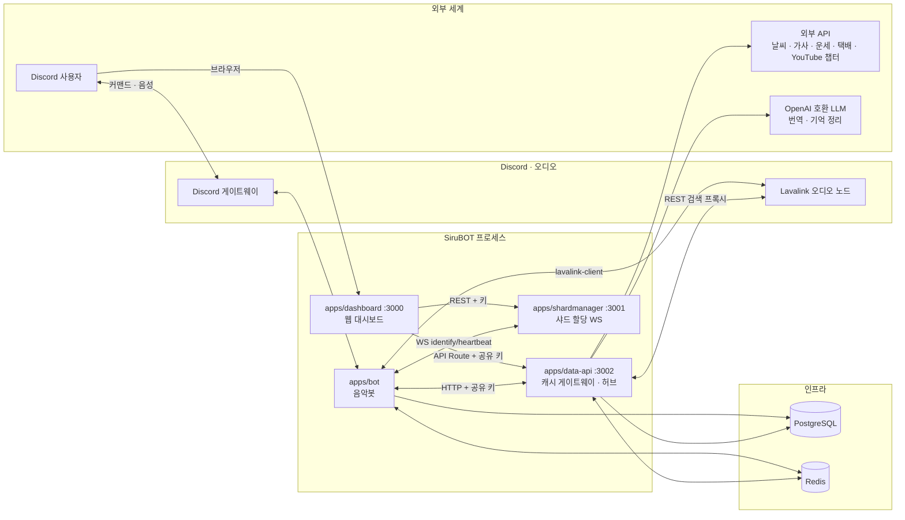
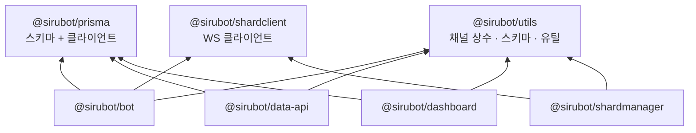
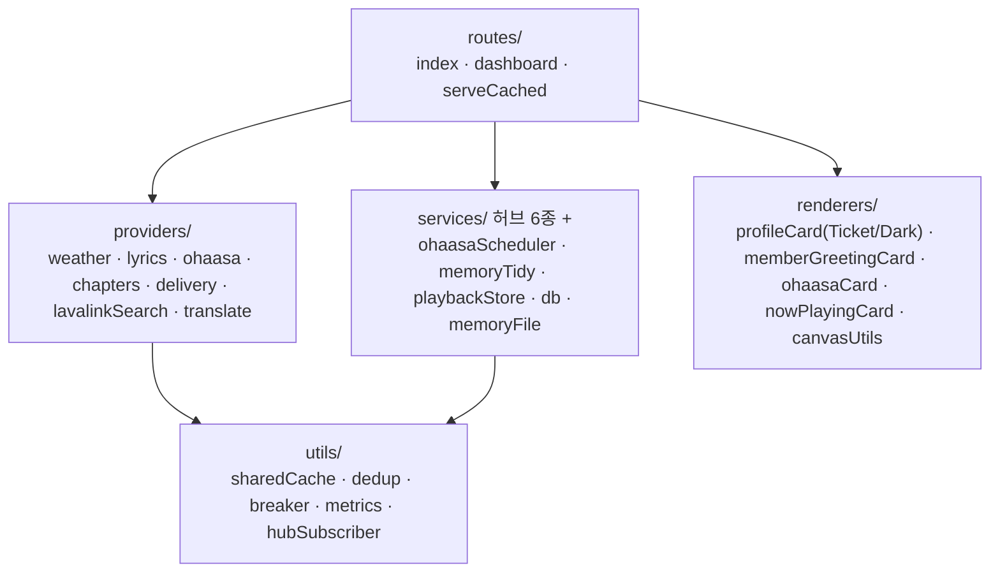
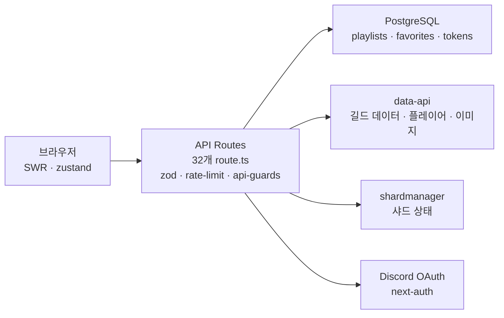
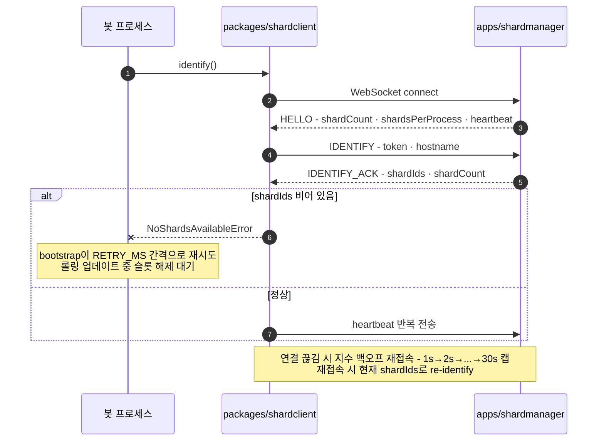
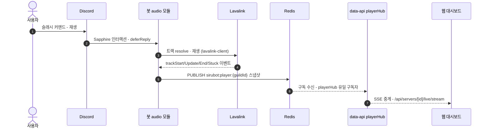
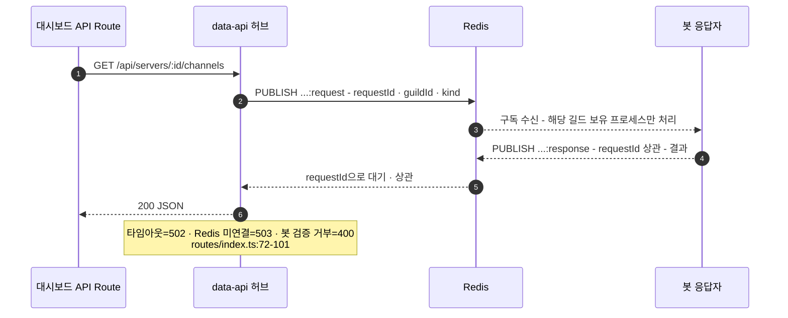
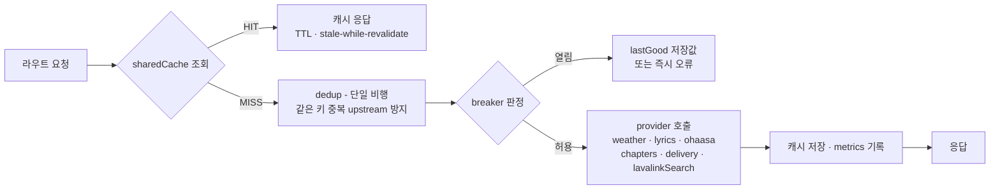
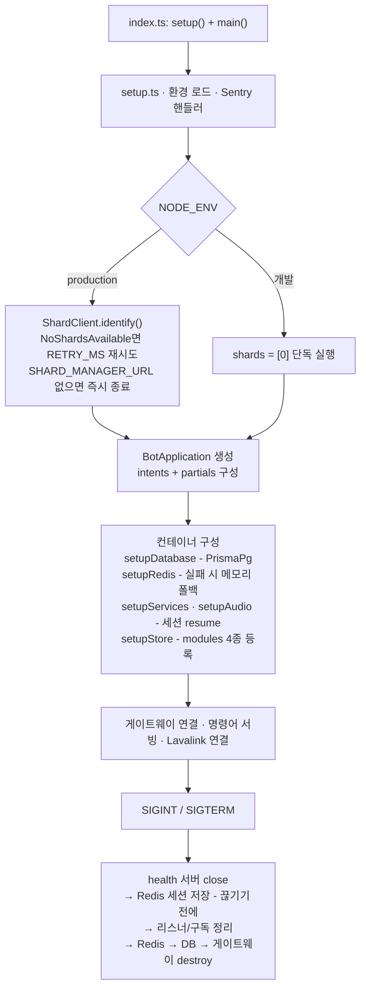

# SiruBOT 아키텍처

> **문서 기준일**: 2026-10-15 (2026-10-16 추기) · 검증 방식: 각 섹션에 명시한 소스 경로의 **실제 라인**을 읽고 작성했습니다.
> 코드가 우선입니다. 인용된 `파일경로:라인범위`는 코드 변경 시 함께 갱신해 주세요.
> 각 앱은 독립 프로세스이며, 서로는 아래 "공유 계약"(Redis 채널·HTTP 인증·WS 프로토콜)으로만 통신합니다.

---

## 목차

1. [개요](#1-개요)
2. [시스템 컨텍스트](#2-시스템-컨텍스트)
3. [모노레포 의존성](#3-모노레포-의존성)
4. [앱 상세 — bot / data-api / dashboard / shardmanager](#4-앱-상세)
5. [공유 계약 — Redis 채널 맵 · 인증 · WS 프로토콜](#5-공유-계약)
6. [런타임 플로우](#6-런타임-플로우)
7. [부팅·종료 시퀀스 (봇)](#7-부팅·종료-시퀀스-봇)
8. [영속성](#8-영속성)
9. [빌드·배포·CI](#9-빌드·배포·ci)
10. [환경변수 매트릭스](#10-환경변수-매트릭스)

---

## 1. 개요

SiruBOT은 단일 저장소(모노레포)에 4개의 독립 프로세스 앱과 3개의 공유 패키지로 구성된 Discord 음악봇 플랫폼입니다. 워크스페이스는 `apps/*`, `packages/*`이고(`package.json:5-8`), 빌드/개발 오케스트레이션은 Turborepo(`turbo.json`), Node ≥ 22(`package.json:40-41`), Yarn 4(Corepack)를 사용합니다.

| 구분 | 대상 | 한 줄 정의 | 런타임 |
|---|---|---|---|
| 앱 | `apps/bot` | Discord 게이트웨이·슬래시 커맨드·Lavalink 오디오 파이프라인 | Sapphire( discord.js ) + lavalink-client |
| 앱 | `apps/dashboard` | 길드 관리 웹 대시보드(플레이어·설정·통계·AI 기록) | Next.js 16.4 App Router + React 19 |
| 앱 | `apps/data-api` | 외부 제공자 캐시 게이트웨이·Redis 허브·canvas 이미지 렌더·LLM 배치 | Fastify 5 (포트 3002) |
| 앱 | `apps/shardmanager` | 봇 프로세스(샤드) 할당·헬스 집계 WS 서버 | Fastify 5 + @fastify/websocket |
| 패키지 | `packages/prisma` | PostgreSQL 스키마·Prisma 클라이언트 (10모델) | Prisma 7 + PrismaPg |
| 패키지 | `packages/shardclient` | shardmanager 접속용 WS 클라이언트(재시도·백오프 내장) | ws |
| 패키지 | `packages/utils` | Redis 채널 상수·페이로드 스키마·공용 유틸 | zod |

기본 포트: 대시보드 3000 · shardmanager 3001 · data-api 3002 (`README.ko.md:76-88`, `apps/dashboard/src/lib/shard-api.ts:28`).

---

## 2. 시스템 컨텍스트

핵심 경계 규칙:

- **봇이 data-api를 쓰는가**: `apps/bot/.env`에 `DATA_API_URL`이 있을 때만 사용하고, 없으면 봇이 외부 제공자를 직접 호출합니다(`README.ko.md:112,132`).
- **대시보드는 봇과 직접 통신하지 않습니다.** 채널/역할 목록·플레이어 제어는 전부 data-api의 Redis request/reply 허브를 우회합니다(`packages/utils/src/redisChannels.ts:87-127`). 유저 OAuth 토큰으로는 Discord API를 직접 못 쓰기 때문입니다(`redisChannels.ts:89-93`).
- **data-api는 인증 키가 없으면 기동 거부(fail-closed)**입니다. 인증 면제는 `/api/health`와 내장 모니터링 페이지뿐입니다(`README.ko.md:92-94,106`, `apps/data-api/src/routes/index.ts:104-111`).

---

## 3. 모노레포 의존성

근거: `apps/bot/package.json:32-34`, `apps/data-api/package.json:20-21`, `apps/dashboard/package.json:18-19`, `apps/shardmanager/package.json:20-21`. shardmanager가 shardclient에 의존하는 이유는 서버 측에서 WS 계약 타입(ops/payload)을 공유하기 위함입니다(`packages/shardclient/src/client.ts:5`).

---

## 4. 앱 상세

### 4.1 apps/bot

**부팅 체인**: `apps/bot/src/index.ts:4-5` — `setup()`(환경·Sentry, `core/setup.ts`) → `main()`(샤드 식별 + 애 플리케이션 조립, `core/bootstrap.ts`).

**샤드 식별**(`core/bootstrap.ts:22-61`):

| 모드 | 동작 |
|---|---|
| 개발 (`NODE_ENV != production`) | 단독 실행, `shards: [0]` (`bootstrap.ts:22`) |
| 프로덕션 | `SHARD_MANAGER_URL` 미설정 시 즉시 종료(`:27-31`). `ShardClient.identify()`로 샤드 배정을 받고, `NoShardsAvailableError`면 `SHARD_IDENTIFY_RETRY_MS`마다 무한 재시도(롤링 업데이트 대응) (`:40-57`) |

**컨테이너 구성**(`core/botApplication.ts`):

- `setupRedis()` — 연결 실패 시 **메모리 폴백으로 계속 부팅**(큐·세션은 휘발) (`:44-58`)
- `setupDatabase()` — PrismaClient + PrismaPg 어댑터, `LOGLEVEL >= 4`에서만 쿼리 로깅 (`:60-88`)
- `setupServices()` — 아래 서비스 등록 (`:90-113`)
- `setupAudio()` — LavalinkManager 조립, Redis에서 이전 노드 세션 ID를 읽어 **resume** 준비 (`:115-120`)
- `setupStore()` — `src/modules/{audio,general,voice,games}` 패키지 스토어 등록 (`:39-42`, 디렉터리 실존 확인)

**서비스 인벤토리** (`src/services/`, 24파일 — `botApplication.ts:90-113` 등록 기준):

| 그룹 | 서비스 | 역할 |
|---|---|---|
| 도메인 | `guildService` `trackService` `playlistService` `audioService` `mixerService` `tempVoiceService` `aiMemoryService` `trackData` | 길드 설정 캐시·트랙/플레이리스트·오디오·믹싱·임시방(JTC)·AI 장기기억 |
| Redis 구독 응답자 | `guildSettingsInvalidator` `guildDataResponder` `playerWebResponder` `jtcSetupResponder` `botProfileService` `memberGreetingService` | data-api 허브 요청에 답장하거나 브로드캐스트를 소비 (§5.2 채널 맵) |
| 리포트/연동 | `playbackReporter` `dataApiClient` `ohaasaTranslate` `appEmojiManager` | 재생 이벤트 리포트, data-api HTTP 클라이언트, 운세 번역, 길드 이모지 |
| 모듈(컨테이너 미등록) | `customCommands/{store,interpreter,slashRegistry}` + 접두사 리스너(`general/listeners/message/customCommandPrefix.ts`) + 슬래시 핸들러(`general/listeners/interaction/customCommandSlash.ts`) | 스펙 v2(메시지·CV2 디자인·대기·역할 부여/제거·리액트·고정·지연 삭제·if 분기·인수 치환 `{argv0}`~) + 실행 제한(access). `CustomCommand` 테이블 + 길드별 메모리 캐시(TTL 60초), 실행 전 spec zod 재검증·역할 위계 재검증. 실행 방식(method)이 'prefix'면 "접두사+이름" 트리거(3초 쿨다운·`!도움말` 목록), 'slash'면 길드 애플리케이션 커맨드로 등록(ID 기반 증분 동기화, 길드당 20슬롯) 후 슬래시로 실행 (`customCommand.ts`, `interpreter.ts`, `slashRegistry.ts`, `customCommandPrefix.ts`, `customCommandSlash.ts`) |

**오디오 이벤트 경로**: 재생 상태는 봇이 `sirubot:player:{guildId}` 채널로 퍼블리시하고, 유일 구독자인 data-api `playerHub`가 SSE로 대시보드에 중계합니다(`packages/utils/src/redisChannels.ts:68-80`, `apps/dashboard/src/app/api/servers/[id]/live/stream/route.ts`).

**종료 순서**(`core/bootstrap.ts:99-118`): health 서버 close → **Lavalink 노드 세션을 Redis에 저장**(Redis가 끊기면 저장 스킵 — 거짓 성공 로그 방지) → 리스너·구독 정리 → Redis → DB → 게이트웨이 destroy. data-api 쪽 close 순서는 `apps/data-api/src/server.ts:71-83`: 스케줄러 stop → 6개 허브 stop → Redis → DB → Fastify.

### 4.2 apps/data-api

`buildServer()` 조립 순서(`src/server.ts:19-86`):

1. Redis 연결 + **6개 허브 기동**: playerHub · botProfileHub · memberGreetingHub · guildDataHub · playerWebHub · jtcSetupHub (`:22-28`)
2. canvas 한글 폰트 프리로드 (첫 렌더가 폰트 로드로 지연되지 않도록) (`:30-32`)
3. OpenAI 호환 번역 프로바이더 (미설정 시 원문 운세 서빙 경고) (`:34-41`)
4. auth 플러그인 + 라우트 등록 — Lavalink REST 주소/비밀번호 주입 (검색 프록시용) (`:51-58`)
5. 운세 스케줄러 (매일 KST 06:50 캐시 선-채움) (`:60`)
6. DB 연결 + **메모리 정리 nightly 스케줄러** — DB+프로바이더가 있을 때만 활성 (`:64-69`)

**레이어**:

**봇 릴레이 실패 매핑**(`src/routes/index.ts:72-101`, 3개 릴레이 흐름(guild-data·player-web·jtc-setup) 공통):

| 사유 | HTTP | 의미 |
|---|---|---|
| `redis_unavailable` | 503 | Redis 미연결 |
| `timeout` | 502 | 봇이 해당 길드를 없거나 미응답 |
| `bot_error` | 400 | 봇이 실어 보낸 검증 거부/오류 |

**엔드포인트·TTL** (`README.ko.md:114-131`, 코드 상수 `routes/index.ts:43-44`):

| 엔드포인트 | 설명 | 캐시 TTL |
|---|---|---|
| `GET /api/health` | 헬스체크 — **유일한 인증 면제 경로 중 하나** | — |
| `GET /v1/status` | 캐시 적중률·inflight·브레이커 스냅샷 (`routes/index.ts:113`) | — |
| `GET /v1/ohaasa` | 오하아사 운세 + LLM 한국어 번역 | 7일(스케줄러 선-채움) |
| `GET /v1/lyrics?q=` | 가사 검색(lrclib.net) | **30일** (`routes/index.ts:43`) |
| `GET /v1/weather` | 지오코딩+예보+대기질(Open-Meteo) | **15분** (`routes/index.ts:44`) |
| `GET /v1/chapters` | 장문 YouTube 챕터 마커 | 12시간 |
| `GET /v1/delivery/track` | 택배 조회(tracker.delivery) | 5분 |
| `POST /v1/playback/events` · `GET /v1/playback/recent` | 샤드 재생 이벤트 수집/조회 (`services/playbackStore.ts`) | — |
| `POST /v1/image/profile` 등 | canvas PNG 렌더(프로필·인사·운세·Now Playing 카드) | — |
| `/dashboard` | 내장 모니터링 대시보드(서드파티 0) — 인증 면제 대상 (`routes/index.ts:110-111`) | — |

### 4.3 apps/dashboard

스택(`package.json:14-37`): Next.js 16.4(React 19), next-auth 5 beta(**Discord OAuth**), SWR + zustand(클라이언트 상태), zod(API Route 검증), Tailwind v4, framer-motion.

**데이터 접근 3계층** — 브라우저 →(SWR/fetcher)→ **Next API Route(zod · rate-limit · 권한 체크)** → { DB(prisma 직접) | data-api | shardmanager }:

- **API Route 인벤토리**(`src/app/api/**/route.ts`, 32개): `auth/[...nextauth]` · `playlists`(/reorder, /tracks, /search) · `favorites` · `shards` · `data-api`(범용 프록시) · `tracks` · `servers` · `servers/[id]/`{`channels`, `roles`, `settings`, `player`(+`play`/`command`/`search`/`voice-context`), `greeting`(+`preview`/`test`/`status`/`background`/`layer-image`), `jtc/setup`, `bot-profile`, `ai`(+`history`), `live`, `live/stream`(SSE), `stats`}
- **shard-api 규약**(`src/lib/shard-api.ts:28-58`): `SHARD_MANAGER_AUTH_KEY` **미설정 시 에러 — 폴백 없음** (`:31-37`). `Authorization` 헤더에 키 **원문**(Bearer 없음)으로 `/api/shards` 호출 (`:48-53`).
- **data-api 프록시**(`src/lib/data-api.ts`): `DataApiStatus` 타입(`:23`), `openDataApiStream`(`:77`)은 SSE 장기 연결이라 `AbortSignal.timeout`을 걸지 않습니다 — 타임아웃이 스트림 전체를 끊기 때문.
- 라이브러리 레이어(`src/lib/`): `rate-limit.ts` `api-guards.ts` `api-error.ts` `fetcher.ts` `auth.ts` `token-store.ts` `session-token.ts` `redis.ts` `guild-permissions.ts` `schemas.ts` 등.

### 4.4 apps/shardmanager

- Fastify + `@fastify/websocket`, 전역 에러 핸들러, auth 플러그인, routes autoload(`src/server.ts:32-49`).
- 코어: `ShardRegistry(shardCount, shardsPerProcess)` — 샤드↔프로세스 할당 원장, 장애 감지 알림용 `DiscordNotifier`(웹훅) (`server.ts:21-30`).
- 엔드포인트: REST `/api/health` · `/api/shards` · `/api/shards/:id` · `/api/shard/count`, WS `ws://{host}:{port}/ws` (`server.ts:61`, `src/routes/`).
- graceful stop: registry destroy → Fastify close (`server.ts:69-77`).

---

## 5. 공유 계약

### 5.1 bot ↔ shardmanager WS 프로토콜

`packages/shardclient/src/client.ts`가 클라이언트 단 구현이고, shardmanager가 서버 단입니다. ops: `HELLO`, `IDENTIFY`, `IDENTIFY_ACK`, `STATS`, `STATUS`(`client.ts:5`).

근거: HELLO→IDENTIFY→ACK 핸드셰이크와 10s ACK 타임아웃(`client.ts:104-122`), 빈 shardIds → `NoShardsAvailableError`(`:128-131`), 연결 끊김 → 백오프 재접속 최대 30s(`:67-91`), re-identify(`:93-98,116-121`). 네트워크 오류는 5s 재시도, `NoShardsAvailableError`만 상위로 전파(`:42-62`) — 이후 bootstrap 레벨에서 재시도 간격 제어(`bootstrap.ts:40-57`).

### 5.2 Redis Pub/Sub 채널 맵

한 곳에 상수로 관리됩니다: `packages/utils/src/redisChannels.ts`. 봇 프로세스는 여러 개지만 Redis 채널이 접점입니다.

| 채널 | 게시자 | 구독자 | 용도 · 비고 | 근거 |
|---|---|---|---|---|
| `sirubot:guild-settings:invalidate` | data-api | **봇 전체** | 설정 저장 → 각 봇 프로세스가 자기 GuildService 캐시 해당 길드만 비움(다음 조회 DB 재-읽기). 같은 브로드캐스트가 커스텀 명령어 메모리 캐시도 함께 비우고, 슬래시형 커스텀 명령어 등록/해제 동기화를 트리거해요 | `redisChannels.ts:6-13`, `guildSettingsInvalidator.ts` |
| `sirubot:bot-profile:set` | data-api | 해당 길드 봇 | 닉네임/아바타 적용. **본문은 `sirubot:bot-profile:pending:{guildId}` 키로**(아바타 데이터 URI가 커서 복제 방지) | `:15-38` |
| `sirubot:bot-profile:refresh` | data-api | 해당 길드 봇 | 최신 상태 요청(화면 조회/재시도) | `:26-27` |
| `sirubot:bot-profile:state:{guildId}` | 봇 | data-api | 적용 결과 퍼블리시 | `:29-43` |
| `sirubot:member-greeting:send` | data-api | 해당 길드 봇 | 인사 카드 테스트 전송. 본문은 pending 키({kind, userId, requestId}) | `:45-58` |
| `sirubot:member-greeting:state:{guildId}` | 봇 | data-api | 인사 테스트 결과 | `:60-66` |
| `sirubot:player:{guildId}` | 봇 | data-api **playerHub 유일 구독자** | 플레이어 실시간 스냅샷(스키마: `utils/playerState.ts`) — SSE 중계됨 | `:68-85` |
| `sirubot:guild-data:request` | data-api | 봇 전체 | 채널/역할 목록 조회. 페이로드에 `requestId` 상관 키 | `:87-94` |
| `sirubot:guild-data:response` | 봇(보유 프로세스만) | data-api guildDataHub | requestId 상관으로 응답 | `:96-102` |
| `sirubot:player-web:request` | data-api | 해당 길드 봇 | 웹 플레이어 제어. kind: `search`/`play`/`control`/`voice-context` — 음성채널·DJ 권한 해석은 봇 캐시로만 가능 | `:104-115` |
| `sirubot:player-web:response` | 봇 | data-api playerWebHub | requestId 상관 응답(타임아웃 포함) | `:104-115` |
| `sirubot:jtc-setup:request` | data-api | 해당 길드 봇 | JTC 마커 채널 생성·이동 — 유저 OAuth 토큰으로 불가한 봇 토큰 작업 | `:117-127` |
| `sirubot:jtc-setup:response` | 봇 | data-api jtcSetupHub | requestId 상관 응답 | `:126-127` |

### 5.3 HTTP 인증 규약

| 경로 | 인증 | 근거 |
|---|---|---|
| dashboard → data-api | `DATA_API_AUTH_KEY ?? AUTH_KEY` — **키 없으면 data-api 기동 거부(fail-closed)**. 헤더는 Bearer 없이 키 원문. 인증 면제는 `/api/health`·`/dashboard`뿐 | `README.ko.md:92-94,106`, `routes/index.ts:104-111` |
| bot(data-api 클라이언트) | 위와 동일한 키 — **3앱(bot·dashboard·data-api)이 같은 키 공유** | `README.ko.md:106` |
| dashboard → shardmanager | `SHARD_MANAGER_AUTH_KEY` — 미설정 시 **에러, 폴백 없음**. 헤더 키 원문 | `shard-api.ts:31-53` |
| bot → shardmanager(WS) | WS 연결 Authorization 헤더에 AUTH_KEY, IDENTIFY에 Discord 토큰 | `client.ts:10-12,32-36`, `bootstrap.ts:33-38` |

---

## 6. 런타임 플로우

### 6.1 음악 재생 → 대시보드 실시간

근거: 채널·유일 구독자 규칙 `redisChannels.ts:68-80`, SSE 라우트 `apps/dashboard/src/app/api/servers/[id]/live/stream/route.ts`, playerHub 구현 `apps/data-api/src/services/playerHub.ts`.

재생 시작/종료/끊김/오류는 별도로 `playbackReporter`가 data-api `/v1/playback/events`(POST)로 리포트되고 `/v1/playback/recent`로 조회됩니다(`README.ko.md:121-122`, 봇 `services/playbackReporter.ts`, data-api `services/playbackStore.ts`).

### 6.2 Redis request/reply — 대시보드가 "봇에게 물어보는" 표준 패턴

guild-data, player-web, jtc-setup 3흐름이 모두 이 패턴입니다(`routes/index.ts:72-74` 주석 명시).

이 패턴이 필요한 이유: 대시보드가 유저 OAuth 토큰으로 Discord API를 직접 호출하면 401이 나므로, 채널/역할 목록·음성 컨텍스트·봇-토큰 작업은 "봇이 대신 답"하게 우회합니다(`redisChannels.ts:87-93,105-110,118-122`).

### 6.3 외부 제공자 캐싱 (serveCached + dedup + breaker)

근거: `apps/data-api/src/utils/{cache,dedup,breaker,metrics}.ts`, `routes/serveCached.ts`. 각 TTL은 §4.2 표. 운세는 스케줄러가 매일 KST 06:50 미리 채워 둡니다(`README.ko.md:128-129`, `server.ts:60`).

### 6.4 대시보드 설정 저장 → 봇 캐시 무효화

대시보드 설정 저장(API Route → DB) → data-api가 `sirubot:guild-settings:invalidate` 퍼블리시 → **모든** 봇 프로세스가 구독, 자기 캐시의 해당 길드만 비움 → 다음 조회가 DB에서 재-읽기(`redisChannels.ts:6-13`). 플레이어 실시간 상태는 이와 반대 방향(봇 → data-api → SSE)으로 흐르는데, **봇의 데이터 캐시에 대한 유일한 외부 수정 경로**가 이 무효화 브로드캐스트입니다.

---

## 7. 부팅·종료 시퀀스 (봇)

부팅 근거: `index.ts:4-5`, `bootstrap.ts:22-61,76-87`, `botApplication.ts:39-120`. 컨테이너 구성 메서드는 구현이 `botApplication.ts`, 호출이 `bootstrap.ts`의 조립 단계에서 이루어집니다.
종료 근거: `bootstrap.ts:89-118` — 재진입 가드(`shutdownStarted`, `:19,91-93`)와 "종료 순서: 세션 저장 → 리스너 정리 → Redis → DB → 샤드 클라이언트(세션 저장은 Redis 끊기 전에)" 주석(`:99`).

롤링 업데이트 시: 새 프로세스는 샤드 슬롯이 비기 전까지 identify 재시도(`bootstrap.ts:41-57`), 연결 성공 후 WS 끊김은 shardclient가 백오프로 자가 복구하고 현재 shardIds로 재식별합니다(`client.ts:145-149`).

---

## 8. 영속성

**PostgreSQL + Prisma 7 (PrismaPg 어댑터)** — `packages/prisma/src/schema.prisma:11-13`(provider postgresql), 클라이언트 생성 `botApplication.ts:71-76`(봇)·`apps/data-api/src/services/db.ts`(data-api). **⚠️ 루트 `package.json:10`의 `mysql2` resolution은 레거시 잔재입니다** — 실제 프로바이더는 postgresql이므로 정리 후보입니다.

**모델 11개**(`schema.prisma`):

| 모델 | 라인 | 대략의 역할 |
|---|---|---|
| `Guild` | 15 | 서버 설정 원장 — 볼륨·컨트롤러·DJ·JTC·크로스페이드·AI 채팅 범위 등 |
| `Track` | 73 | 트랙 메타 |
| `User` | 92 | 유저 |
| `UserToken` | 108 | 유저 토큰(대시보드 OAuth 연동 추정 — 사용처 확인 필요) |
| `GameRecord` | 123 | 게임 기록 |
| `GuildTrackHistory` | 136 | 길드별 재생 이력 |
| `Playlist` / `PlaylistTrack` | 150 / 165 | 커스텀 플레이리스트 |
| `ChannelChatHistory` | 180 | AI 채널 대화 이력 |
| `UserMemory` | 190 | AI 장기 기억(data-api nightly 정리 대상) |
| `CustomCommand` | 57 | 길드별 커스텀 명령어 정의 (스펙 JSON + 실행 방식 method('prefix'/'slash', 생성 후 불변) + 슬래시 등록 ID, §4.1 customCommands 참조) |

**Redis**는 세 계열로 씁니다: ① Lavalink 노드 세션·큐 영속(`modules/audio/lavalink/redisStore.ts`, 종료 저장 `bootstrap.ts:100-118`), ② §5.2 허브 채널, ③ data-api 공유 캐시(`sharedCache`).

---

## 9. 빌드·배포·CI

- **Turborepo 파이프라인**(`turbo.json`): `build` = `^typecheck ^generate ^build` 의존(`:4-8`), `typecheck` = `^build ^generate`(`:31-35`), `test` = `^generate ^build`(`:36-39`), `dev`은 캐시 비활성+persistent(`:12-15`). Prisma 클라이언트 생성(`yarn generate`)이 typecheck/build/test의 선행 조건입니다.
- **CI(`.github/workflows/lint.yml`)**: push/PR 트리거(`:3`), Node 22(`:24-27`), `yarn install --immutable`(`:30`) → `yarn lint`(`:33`) → `yarn typecheck`(`:36`) → `yarn test`(`:39`). 이미지 파이프라인: `docker-publish.yml`, `docker-beta.yml`.
- **Docker**: 루트 Dockerfile이 봇·대시보드·shardmanager·data-api 4개 타겟을 각각 빌드(`README.ko.md:186-196`). 컴포즈: `docker/docker-compose.yml`, `docker-stack.yml`, `docker-stack-infra.yml`.
- **테스트**: 워크스페이스별 vitest(`--passWithNoTests`). 봇·data-api·utils·dashboard·shardclient에 테스트 존재, shardmanager/prisma는 없음.

---

## 10. 환경변수 매트릭스

`README.ko.md:62-104` 요약. 값은 절대 커밋하지 마세요.

| 환경변수 | bot | dashboard | data-api | shardmanager |
|---|:-:|:-:|:-:|:-:|
| `DISCORD_TOKEN` | ✅ | — | — | — |
| `DATABASE_URL` (PostgreSQL) | ✅ | ✅ | 🔸 기억 정리용 | — |
| `REDIS_URL` | ✅ 실패 시 메모리 폴백 | ✅ | 🔸 미설정 시 메모리 폴백 | — |
| `LAVALINK_HOSTS` (`id_host_port[\_password]` 콤마 목록) | ✅ zod 파싱 실패 시 기동 중단 | — | — | — |
| `DISCORD_CLIENT_ID` / `CLIENT_SECRET` | — | ✅ | — | — |
| `AUTH_SECRET` | — | ✅ | — | — |
| `DATA_API_URL` | 🔸 설정 시에만 게이트웨이 사용(기본 3002) | ✅ 기본 3002 | — | — |
| `DATA_API_AUTH_KEY` 또는 `AUTH_KEY` | ✅ | ✅ | ✅ **둘 다 없으면 기동 거부** | — |
| `SHARD_MANAGER_URL` | 🔸 프로덕션 필수, 없으면 종료 | 🔸 대시보드 상태 조회(기본 3001) | — | — |
| `SHARD_MANAGER_AUTH_KEY` | (bot은 `AUTH_KEY` 사용) | ✅ 폴백 없음 | — | ✅ |
| `OPENAI_COMPATIBLE_API_URL` / `OPENAI_API_KEY` / `TRANSLATION_MODEL` | — | — | 🔸 운세 번역·기억 정리 | — |
| `CUSTOM_COMMAND_DRAFT_MODEL` | — | — | 🔸 초안·반복 수정 모델, 미설정 시 `TRANSLATION_MODEL`로 폴백 (`config/env.ts:13-14`, `server.ts:42-47`) | — |
| `PORT` · `HOSTNAME` · `DISCORD_WEBHOOK_URL` (shardmanager) | — | — | — | ✅ `server.ts:25,28` |

---

## 부록 A. 검증 근거 색인

| 주제 | 경로:라인 |
|---|---|
| 워크스페이스·엔진 | `package.json:5-8,40-41` |
| 봇 부팅·샤드 식별·shutdown | `apps/bot/src/index.ts:4-5`, `apps/bot/src/core/bootstrap.ts:22-61,76-118`, `apps/bot/src/core/botApplication.ts:31-120` |
| WS identify 프로토콜 | `packages/shardclient/src/client.ts:5,10-12,32-36,42-62,67-98,104-149` |
| Redis 채널 계약 전체 | `packages/utils/src/redisChannels.ts:1-127` |
| data-api 조립·허브·close | `apps/data-api/src/server.ts:19-86` |
| 커스텀 명령어 계약·실행·초안·수정 | `packages/utils/src/customCommand.ts`, `apps/bot/src/services/customCommands/{store.ts,interpreter.ts,slashRegistry.ts}`, `apps/bot/src/modules/general/{listeners/message/customCommandPrefix.ts,listeners/interaction/customCommandSlash.ts}`, `apps/data-api/src/routes/{customCommandDraft.ts,customCommandRefine.ts,index.ts}` |
| data-api 릴레이 실패 매핑·TTL | `apps/data-api/src/routes/index.ts:43-44,72-101,104-111,113` |
| 대시보드 스택·shard-api 규약 | `apps/dashboard/package.json:14-37`, `apps/dashboard/src/lib/shard-api.ts:28-58`, `apps/dashboard/src/lib/data-api.ts:23,77` |
| shardmanager 서버·엔드포인트 | `apps/shardmanager/src/server.ts:11-94`, `apps/shardmanager/src/routes/{ws/index,api/shards/index,api/shards/[id],api/shard/count,api/health/health}.ts` |
| 스키마·모델 | `packages/prisma/src/schema.prisma:11-13,15-169` |
| 파이프라인·CI | `turbo.json:4-39`, `.github/workflows/lint.yml:3,24-39` |
| 엔드포인트·환경변수 원문 | `README.ko.md:62-131,186-196` |