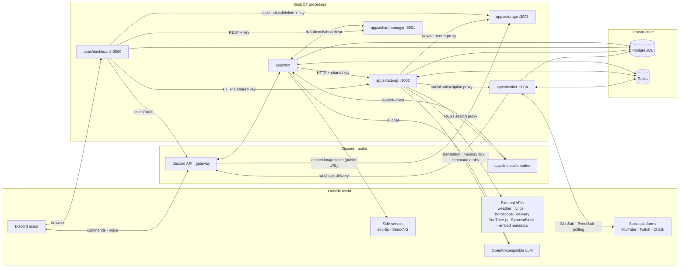
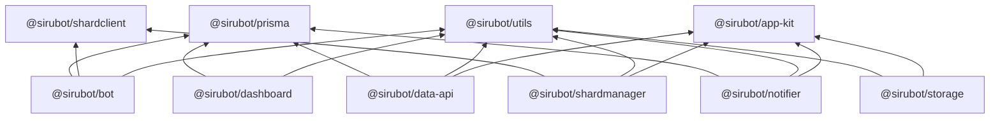
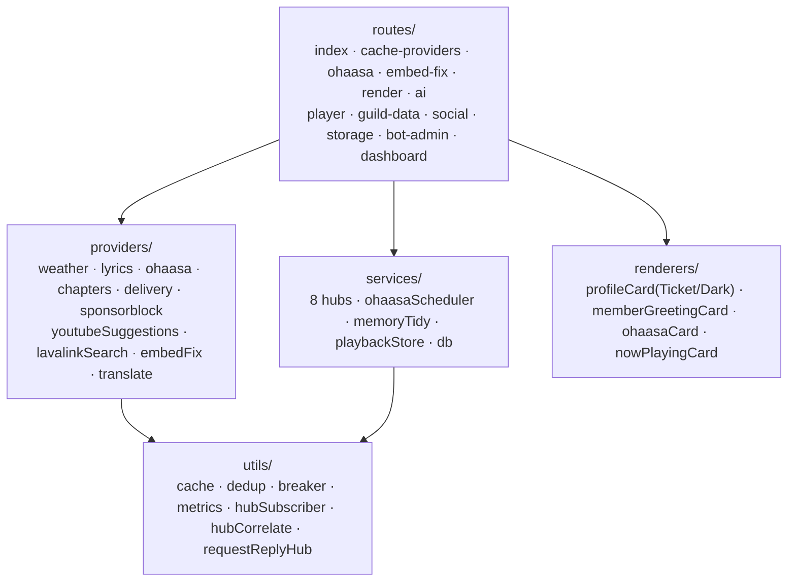
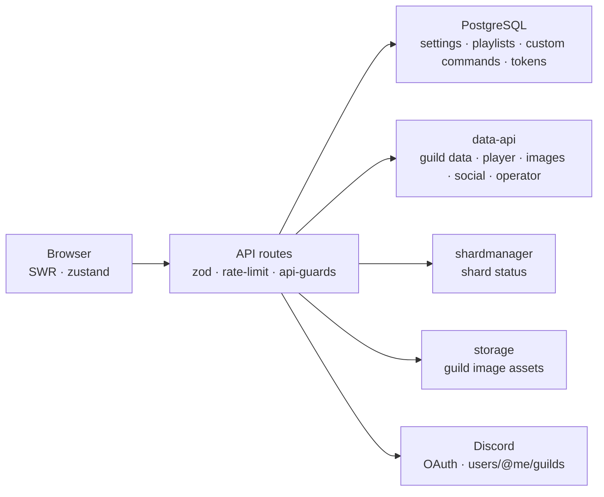
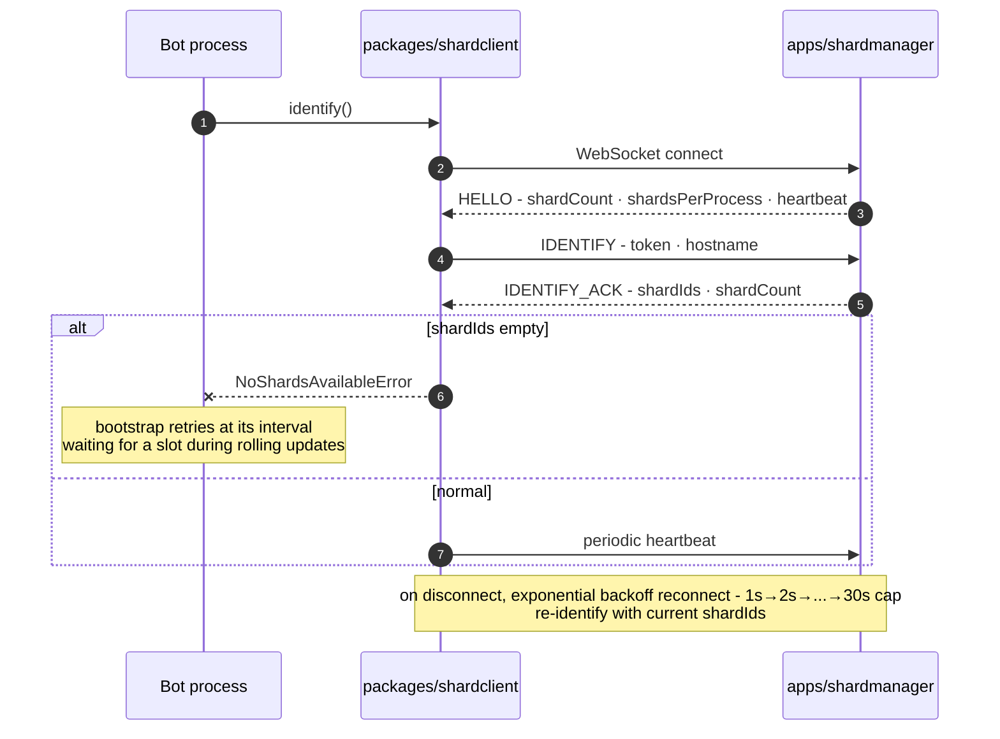
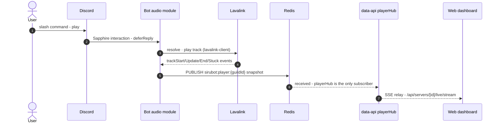
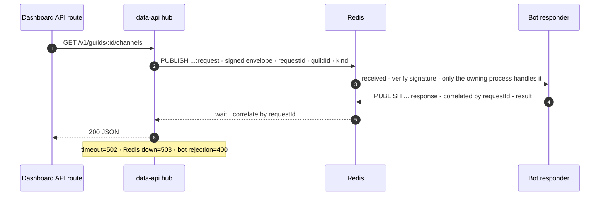
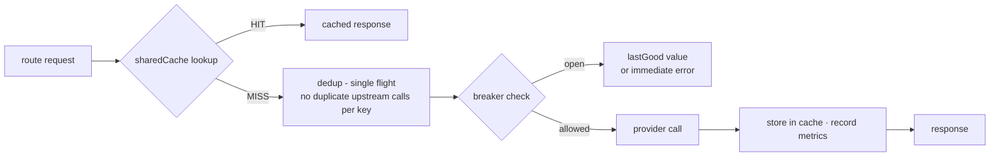
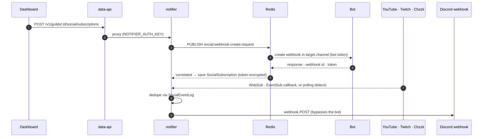
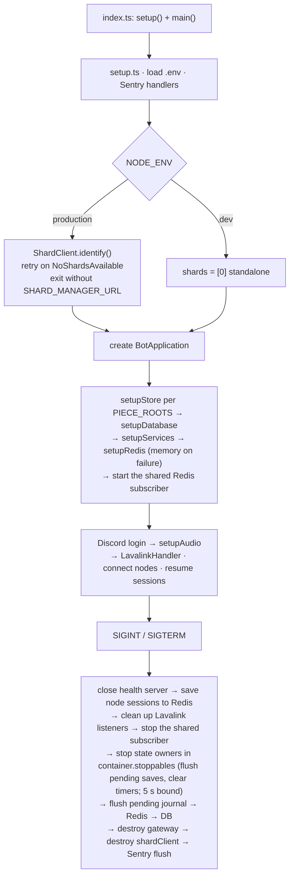

# SiruBOT Architecture

> **As of**: 2026-11-11 · Verified by reading the source files cited in each section.
> Code wins. Citations give file paths only, never line numbers (they drift as soon as code changes).
> Each app is an independent process; they talk only through the "shared contracts" below (Redis channels, HTTP auth, WS protocol).

---

## Contents

1. [Overview](#1-overview)
2. [System context](#2-system-context)
3. [Monorepo dependencies](#3-monorepo-dependencies)
4. [Apps — bot / data-api / dashboard / shardmanager / storage / notifier](#4-apps)
5. [Shared contracts — WS protocol · Redis channel map · auth](#5-shared-contracts)
6. [Runtime flows](#6-runtime-flows)
7. [Bot boot and shutdown](#7-bot-boot-and-shutdown)
8. [Persistence](#8-persistence)
9. [Build, deploy, CI](#9-build-deploy-ci)
10. [Environment variables](#10-environment-variables)

---

## 1. Overview

SiruBOT is a Discord music bot platform: one monorepo with 6 independent process apps and 4 shared packages. Workspaces are `apps/*` and `packages/*` (`package.json`), orchestrated by Turborepo (`turbo.json`), on Node ≥ 22 and Yarn 4 (Corepack).

| Kind | Target | One-line definition | Runtime |
|---|---|---|---|
| App | `apps/bot` | Discord gateway, slash commands, Lavalink audio, AI chat, TTS, tickets | Sapphire (discord.js) + lavalink-client |
| App | `apps/dashboard` | Guild management web dashboard (player, settings, stats, social alerts, tickets, operator panel) | Next.js 16.4 App Router + React 19 |
| App | `apps/data-api` | Gateway: external provider cache, Redis hubs, canvas image rendering, LLM batch jobs, notifier/storage proxy | Fastify 5 (port 3002) |
| App | `apps/shardmanager` | Shard assignment and health aggregation WS server for bot processes | Fastify 5 + @fastify/websocket (port 3001) |
| App | `apps/storage` | Object storage — authenticated upload, public GET (Discord embed assets), private bucket (ticket transcripts) | Fastify 5 (port 3003) |
| App | `apps/notifier` | Social alerts — YouTube (WebSub + RSS), Twitch (EventSub), Chzzk (polling) → Discord webhooks | Fastify 5 (port 3004) |
| Package | `packages/prisma` | PostgreSQL schema + Prisma client (19 models) | Prisma 7 + PrismaPg |
| Package | `packages/shardclient` | WS client for shardmanager (retry and backoff built in) | ws |
| Package | `packages/utils` | Redis channel constants, signed envelopes, zod contracts, shared utilities | zod |
| Package | `packages/app-kit` | Shared auth hooks, env validation, logger, error handler for the 4 Fastify apps | Fastify |

Default ports come from each app's `PORT` default in `config/env.ts` (dashboard 3000 is the Next default).

---

## 2. System context

Boundary rules:

- **data-api owns external providers.** Horoscope, weather, lyrics, delivery tracking, YouTube chapters, SponsorBlock, embed metadata, and LLM batch jobs (horoscope translation, memory tidy, custom-command drafts) all go through it. The bot has no local fallback: without `DATA_API_URL`, `dataApiClient.gatewayGet` fails immediately (`apps/bot/src/services/dataApiClient.ts`). Exceptions the bot calls directly: the AI chat LLM (`features/ai-chat/chatConfig.ts`), the TTS server, and SearXNG web search.
- **The dashboard never talks to the bot directly.** It reads and writes the DB via Prisma. Anything needing the bot's cache or bot token (channel/role lists, player control, JTC, bot profile, operator control) goes through data-api's Redis request/reply hubs (§6.2). The user OAuth token is only for user-scope calls: `users/@me/guilds`, token refresh, and guild metadata for the greeting preview.
- **data-api, storage, and notifier refuse to start without an auth key (fail-closed).** Exempt routes: data-api `/api/health`; storage `/health` and public GETs; notifier `/health` and platform callbacks (`/pubsub/youtube`, `/eventsub/twitch`, each signature-verified).
- **Redis messages are signed.** bot, data-api, and notifier wrap them in an HMAC envelope keyed by `REDIS_AUTH_KEY ?? AUTH_KEY` (`packages/utils/src/redisEnvelope.ts`). A side with a key drops unsigned messages, so keys must match across deploys.

---

## 3. Monorepo dependencies

Source: `@sirubot/*` dependencies in each app's `package.json`. shardmanager depends on shardclient to share the WS contract types (ops/payloads) (`packages/shardclient/src/client.ts`). The dashboard imports utils through subpaths only, because of the client bundle (`apps/dashboard/eslint.config.mjs`).

---

## 4. Apps

### 4.1 apps/bot

**Boot chain**: `src/index.ts` → `setup()` (`.env`, Sentry; `core/setup.ts`) → `main()` (`core/bootstrap.ts`, a short step list). The steps live in `core/{shardIdentity,botClient,healthServer,lavalinkSetup,shutdown,redisSubscribers,pieceRoots}.ts`; assembly methods live in `core/botApplication.ts`.

**Config**: bot env values are parsed once into a typed Config in `lib/config.ts` (`loadConfig`, `getConfig()`); `process.env` is read nowhere else (`core/environment.ts` only loads `.env`). `features/*/application/` receives values through deps (for example `emptyGraceMs` for temp voice), and tests pass a Config (`makeTestConfig` in `lib/config.testing.ts`, `setConfigForTesting`).

**Shard identify** (`core/shardIdentity.ts`):

| Mode | Behavior |
|---|---|
| Dev (`NODE_ENV != production`) | Standalone, `shards: [0]` |
| Production | Exits immediately without `SHARD_MANAGER_URL` or `AUTH_KEY`. Gets shards from `ShardClient.identify()`; on `NoShardsAvailableError` retries forever at the retry interval (rolling updates) |

**Assembly order** (`core/bootstrap.ts`): `setupStore()` for each root in `PIECE_ROOTS` (`core/pieceRoots.ts`: `features/music/discord`, `modules/general`, then the `features/*/discord` roots) → `setupDatabase()` (PrismaPg) → `setupServices()` → `setupRedis()` (on failure **keeps booting memory-only**; queue and sessions become volatile) → `startRedisSubscribers()` over `container.redisSubscribers`, which holds one shared Redis subscription for all responders and event listeners (start never throws; it reconnects with backoff) → Discord login → `setupLavalink()` (`parseLavalinkHosts` → `setupAudio()` → register `LavalinkHandler` + connect nodes) → health server.

**Code layout**: `modules/{audio,general}` hold Sapphire pieces. Feature folders `features/<name>/` (`tickets`, `role-panels`, `temp-voice`, `games`, `custom-commands`, `greeting`, `dashboard-bridge`, plus `music` with the application layer and the web player responder) each have `index.ts` (public surface), `application/` (use cases, no Sapphire/views/config; collaborators arrive through a `deps` object and rendering goes through ports implemented in `discord/`), `discord/{commands,listeners,interaction-handlers,views}` and, where needed, `inbound/` (Redis responders and event listeners). Other code imports a feature only through its `index.ts`. Import rules and the Sapphire piece inventory are guarded by `src/architecture.test.ts` and `core/pieceInventory.test.ts` (allowlists may only shrink).

**Music application layer** (`features/music/application/{actor,access,control}.ts`, exposed as `container.music`): `setVolume`, `pause`, `resume`, `setRepeat`, `seek`, `stop`, `skipNow`, `previous`. Slash subcommands, controller buttons, the dashboard web player responder and AI tools are adapters over it, under one policy in `access.ts`: same voice channel as the bot plus "DJ role or alone"; Administrator, ManageGuild and DJ-role holders (`hasRemoteControl`) are exempt from both and may control from outside voice. Adding tracks follows `canAddTracks` (same voice channel for anyone; remote controllers from anywhere while the bot is in a channel), and the dashboard's `canPlay`/`canControl` flags are computed with the same functions. Vote-skip (`/건너뛰기`) is its own use case, `createVoteSkip` in `features/music/application/voteSkip.ts` (`container.voteSkip`: `request`, `castVote`, `closeVote`): it decides immediate skips (forced with DJ rights, skip-to, requester's own track, bot or related track, alone in the channel) or opens a vote, keeps the open votes in the instance, and performs the skip through `container.music.skipApproved` (the same mixer skip as `skipNow`, without a second access check). Discord only renders the vote message in `features/music/discord/managers/voteSkip.ts`. Adding tracks is its own use case, `createMusicPlay` in `features/music/application/play.ts` (`container.musicPlay`: `search`, `preview`, `play`, `enqueue`, `startPlayback`); `/재생`, `/검색`, the command channel, AI `music_play` and the web player call it, and `AudioService` keeps only the playback mechanics. Use cases throw `AppError` (`lib/appError.ts`); `lib/errorPresenter.ts` renders it in both central error listeners. The music volume limit is shared with the dashboard via `@sirubot/utils/playerLimits`.

**Service inventory** (`src/services/` unless a feature path is shown; container assignment in `BotApplication.setupServices`, `core/botApplication.ts`):

| Group | Services | Role |
|---|---|---|
| Domain | `guildService` (+ split stores in `guildSettings/`) `trackService` `playlistService` `audioService` `mixerService` `features/temp-voice/application/tempVoiceService` `features/tickets/application/ticketService` `features/role-panels/application/rolePanelService` | Guild settings cache (60 s TTL), tracks/playlists, audio, mixer (AutoMix), temp voice channels (JTC), tickets, role panels |
| AI | `features/ai-chat/application/` (`aiChatService` + `aiChat/` agent loop, summarizer, token budget, memory promotion; `aiTools/`; `aiMemoryService`) | Mention-triggered AI chat (`features/ai-chat/discord/listeners/mentionReply.ts`), tool calls, long-term memory |
| Voice | `features/tts/application/` (`ttsService` `ttsUserSettings` `ttsPronunciation` `chatTts`) | siru-tts synthesis, per-user voice settings, read-aloud of chat |
| Playback helpers | `sponsorBlockService` `playlistPlayback` `trackData` | SponsorBlock segment skipping (via data-api), playlist playback |
| Redis responders and listeners (one shared subscription in `container.redisSubscribers`) | Built with `createRedisResponder` / `createGlobalRedisResponder` / `createRedisEventListener` (`lib/redisResponder.ts`) and published through `RedisPublisher` (`lib/redisPublisher.ts`). Handlers: `features/dashboard-bridge/inbound/{guildData,botAdmin,socialWebhook,panelPost,guildSettingsInvalidation,botProfile}.ts`, `features/music/inbound/playerWeb.ts`, `features/temp-voice/inbound/jtcSetup.ts`, `features/role-panels/inbound/{roleValidation,rolePanelPost}.ts`, `features/tickets/inbound/ticketPanelPost.ts`, `features/greeting/inbound/memberGreetingSend.ts`. State owners stay in `services/botProfileService.ts` and `features/greeting/application/memberGreetingService.ts` (built with deps in `setupServices`) | Answer hub requests or consume broadcasts (§5.2) |

Services are built by `BotApplication.setupServices` with explicit `deps` (db, `AppLogger`, narrow service types, config values, lazy getters for `redisStore`, `client`, `audio`, `playerNotifier` and for services that reference each other such as `mixerService`) and stay reachable as `container.<name>`. They never import `container` (guarded by `SERVICES_CONTAINER_ALLOWED` in `architecture.test.ts`, which is empty). The audio playback services (`features/music/application/{audioService,mixerService,sponsorBlockService,playlistPlayback}.ts` and `features/music/application/playbackReporter.ts`) are wired the same way and exposed as `container.audioService`, `container.mixerService`, `container.sponsorBlockService`, `container.playbackReporter` and `container.playlistPlayback`. They take config values as plain deps (`mixerService` gets `callTimeoutMs`), and `sponsorBlockService` takes a `messages` render port implemented in `features/music/discord/playbackMessages.ts`. The Lavalink layer (`features/music/lavalink/`) does not read `container` either: its handlers, `PlayerNotifier`, the Redis stores, the now-playing card and the player-state publisher take a `LavalinkDeps` object (`features/music/lavalink/deps.ts`) that `setupServices` builds once as `container.lavalink`. Values created later in boot (`audio`, `client`, `redisStore`, `playerNotifier`, `shardInfo`) are getters; the card cache and publish throttle are plain objects owned by that deps object. Helpers that touch services take `deps` as their first argument. The application services that call those helpers (`mixerService`, `audioService`, `sponsorBlockService`) receive the same object as `lavalink`, and the SponsorBlock outro arm gets `handleMixerNeedNext` injected instead of a dynamic `import()`. `LAVALINK_CONTAINER_ALLOWED` in `architecture.test.ts` is empty. The mixer REST types and `MixerRequestError` live in `features/music/lavalink/mixerProtocol.ts`, so `mixerService` and the mixer handlers do not import each other; the vote-skip use case (`features/music/application/voteSkip.ts`) is wired in `BotApplication.setupVoteSkip` and exposed as `container.voteSkip`; the music Sapphire pieces and Lavalink handlers call them through `container`. Logger-dependent data-api calls live in `container.dataApi` (`createDataApiClient`), the channel webhook cache in `container.webhookRelay`, the AI chat entry points in `container.aiChat` (`createAiChat`) and the AI tool registry comes from `createAiTools(deps)` (`features/ai-chat/application/aiTools/index.ts`).
| Integrations | `dataApiClient` `playbackReporter` `embedFixGateway` `webhookRelay` `appEmojiManager` `userDataService` `countingState` | data-api HTTP client (horoscope, storage upload), playback event reports, embed fixing, webhook relay, app emojis, user data deletion, counting game state |
| Feature (`container.customCommandStore`, `container.customSlashRegistry`) | `features/custom-commands/application/{store,interpreter,slashRegistry}` + `features/custom-commands/discord/listeners/{customCommandPrefix,customCommandSlash}.ts` | Custom commands. Spec contract in `packages/utils/src/customCommand.ts`; spec is zod-revalidated before running. `prefix` method = "prefix+name" trigger (`!도움말` reserved); `slash` method = guild command, ID-based incremental sync |

**Audio event path**: the bot publishes snapshots on `sirubot:player:{guildId}`; data-api `playerHub`, the only subscriber, relays them to the dashboard over SSE (§6.1). Lavalink session restore lives in `features/music/lavalink/handlers/sessionRestore.ts`. Queue list view state (page, selected index) is carried in custom IDs (`features/music/discord/utils/queueViewId.ts`, handler `features/music/discord/interaction-handlers/queueViewButton.ts`), not on the player.

**Custom IDs**: every button, select menu and modal ID in the bot is declared once with `defineCustomId` (`lib/customId.ts`) next to its owner (`features/music/discord/customIds.ts`, `modules/general/customIds.ts`, `features/*/discord/customIds.ts`, `lib/confirmationId.ts`). The format is `{namespace}:v{version}:{action}[:{field}...]` with typed fields that cannot contain the delimiter. Views call `encode`, interaction handlers call `decode` in `parse()` and return `none()` for anything the declaration does not recognise, so IDs from messages posted before a format change simply stop working. Worst-case length is checked against Discord's 100-character limit when the declaration is created, and `lib/customId.namespaces.test.ts` asserts that namespaces are unique.

### 4.2 apps/data-api

**Assembly order** (`src/server.ts`):

1. Connect the shared-cache Redis + **start 8 hubs** from one array in `server.ts`: `playerHub`, `botProfileHub`, `memberGreetingHub`, `guildDataHub`, `playerWebHub`, `jtcSetupHub`, `botAdminHub`, `panelHub`
2. Preload the Korean canvas font
3. Two OpenAI-compatible providers — translation (`TRANSLATION_MODEL`; without it, raw horoscopes are served) and custom-command drafts (`CUSTOM_COMMAND_DRAFT_MODEL ?? TRANSLATION_MODEL`)
4. Shared error handler (`app-kit`) → auth hook → route registration (Lavalink REST, notifier, and storage addresses/keys injected)
5. Start the horoscope scheduler
6. Connect DB + nightly memory-tidy scheduler (`MEMORY_TIDY_*`; only with DB and a provider)

Shutdown: stop schedulers → stop 8 hubs → cache Redis → DB → Fastify.

**Layers**:

**Bot relay failure mapping** (`routes/common.ts` `replyBotRelayFailure`; shared by guild-data, player-web, jtc-setup, bot-admin, panel):

| Reason | HTTP | Meaning |
|---|---|---|
| `redis_unavailable` | 503 | Redis not connected |
| `timeout` | 502 | No bot owns the guild, or it didn't answer |
| `bot_error` | 400 | Validation rejection or error returned by the bot |

**Endpoints** (route files in `src/routes/`, registered in `routes/index.ts`):

| Endpoint | Description | Cache TTL |
|---|---|---|
| `GET /api/health` | Health check — **the only auth-exempt route** | — |
| `GET /dashboard` · `GET /v1/status` | Built-in monitoring page (auth required, prompts for the key) · cache hit rate, inflight, breaker snapshot | — |
| `GET /v1/ohaasa` · `POST /v1/ohaasa/refresh` | Ohaasa horoscope + LLM Korean translation | 7 days (prefilled by scheduler) |
| `GET /v1/lyrics` | Lyrics (lrclib.net) | 30 days |
| `GET /v1/weather` | Geocoding + forecast + air quality (Open-Meteo) | 15 min |
| `GET /v1/delivery/track` · `/carriers` | Parcel tracking (tracker.delivery) | 5 min |
| `GET /v1/chapters` | YouTube.js chapter markers | 12 h, empty result 1 h |
| `GET /v1/youtube/suggestions` · `/search` | YouTube.js autocomplete and search | 10 min |
| `GET /v1/sponsorblock/segments` | SponsorBlock skip segments | 24 h, empty result 1 h, positive stale copy 7 days |
| `POST /v1/embed-fix/metadata` | Social link embed-fix metadata (+ auto translation) | constants in `routes/embed-fix.ts` |
| `POST /v1/image/{profile,member-card,ohaasa,nowplaying}` | canvas PNG rendering | — |
| `POST /v1/ai/custom-command-{draft,refine}` | Custom command draft/refine (503 without a key) | — |
| `POST /v1/playback/events` · `GET /v1/playback/recent` | Collect/query shard playback events (`services/playbackStore.ts`) | — |
| `GET /v1/player/:guildId` (+ `/stream` SSE, `/voice-context`) · `POST /v1/internal/player/{search,play,control}` | Web player | — |
| `GET /v1/guilds/:guildId/{channels,roles,members}` | Guild data from the bot's cache | — |
| `POST /v1/internal/{guild-settings/invalidate,jtc/setup,bot-profile/set,greeting/send,bot-admin}` · `GET /v1/bot-profile/:guildId` · `GET /v1/greeting/state/:guildId` | Dashboard → bot relays and broadcasts | — |
| `/v1/guilds/:guildId/social/subscriptions` (CRUD) · `/v1/social/{youtube,twitch}/resolve` · `/v1/social/chzzk/{search,profile}` | notifier proxy | — |
| `PUT`/`GET /v1/storage/transcripts/*` | storage private-bucket proxy (ticket transcripts) | — |

### 4.3 apps/dashboard

Stack (`package.json`): Next.js 16.4 (React 19), next-auth 5 beta (**Discord OAuth**), SWR + zustand, zod (API route validation), Tailwind v4, framer-motion, `@sentry/nextjs`.

**Data access** — browser → (SWR/fetcher) → **Next API route (zod, rate limit, permission check)** → { DB (Prisma directly) | data-api | shardmanager | storage | Discord (user OAuth) }:

- **API routes** (`src/app/api/**/route.ts`, 57):
  - General: `auth/[...nextauth]` · `playlists` (+ `[id]`, `reorder`, `tracks`, `search`) · `favorites` · `tracks` · `servers` · `shards` (**public**; anonymous requests share one rate-limit bucket) · `voice-servers` (+ `history`) · `data-api` (operator-only generic proxy)
  - Guild (`servers/[id]/`): `settings` `channels` `roles` `stats` `player` (+ `play`/`command`/`search`/`voice-context`) `live` (+ `stream` SSE) `greeting` (+ `preview`/`test`/`status`/`background`/`layer-image`) `jtc/setup` `bot-profile` `ai` (+ `history`) `assets` (+ `[assetId]`) `custom-commands` (+ `[cmdId]`, `draft`, `refine`) `social/*` `ticket` (+ `tickets`, `[ticketId]/transcript`)
  - Operator (`admin/*`, `DASHBOARD_ADMIN_IDS`, fail-closed): `overview` `guilds` `users` `social` `bot-control`
- **Pages**: home, `servers` (+ `[id]`), `player/[id]`, `playlists`, `profile`, `shards` (public), `admin`, `track`, `invite`, `contributors`, `licenses`, `privacy`, `terms`, `design`, `login`, `error`.
- **Client contracts**: data-api (`src/lib/data-api/` — `client.ts`, `player-web.ts`, `jtc.ts`, `guild-members.ts`), shardmanager (`src/lib/shard-api.ts`, `SHARD_MANAGER_AUTH_KEY` with no fallback), storage (`src/lib/storage.ts`, `STORAGE_AUTH_KEY ?? AUTH_KEY`, 15 s timeout). All three send the raw key in `Authorization` (no Bearer). `openDataApiStream` sets no `AbortSignal.timeout` because it's a long-lived SSE connection.
- Library layer (`src/lib/`): `api-handler.ts` (`createGuildApiHandler`, `role: "manage"` permission) · `api-guards.ts` · `rate-limit.ts` · `guild-permissions.ts` · `token-store.ts` (`UserToken` AES-256-GCM, `TOKEN_ENCRYPTION_KEY` → session secret fallback) · `discord-token.ts` · `admin-ids.ts` · `schemas.ts`, and more.

### 4.4 apps/shardmanager

- Fastify + `@fastify/websocket`, shared error handler, auth plugin, routes autoload (`src/server.ts`).
- Core: `ShardRegistry(shardCount, shardsPerProcess)` — the shard ↔ process assignment ledger — and `DiscordNotifier` (webhook) for failure alerts.
- Endpoints: REST `/api/health` · `/api/shards` · `/api/shards/:id` · `/api/shard/count`, WS `/ws` (`src/routes/`).
- The auth key is `AUTH_KEY`. The dashboard sends `SHARD_MANAGER_AUTH_KEY`, so the two values must match.
- Startup grace: for `ALLOCATION_GRACE_MS` (default 40 s, `0` disables) after boot, brand-new shard allocation is deferred (`NoShardsAvailableError` on the client) while re-identify claims of existing shards are still accepted. This keeps a new process from taking shards that bots still in reconnect backoff are about to reclaim after a manager restart.
- Client liveness: `ShardClient` terminates the socket and reconnects when a HEARTBEAT gets no `HEARTBEAT_ACK` within one interval, so a half-open connection can't leave a bot believing it still owns shards the manager already released.
- Graceful stop: registry destroy → Fastify close.

### 4.5 apps/storage

- Fastify 5, no DB — files on a local volume (`STORAGE_DATA_DIR`; in the container `/data` = the `storage-data` volume).
- Auth: refuses to start without `STORAGE_AUTH_KEY ?? AUTH_KEY`. Exempt: `/health` and public object GETs (`src/plugins/auth.ts`). The private bucket (`ticket-transcripts/`) returns 404 on public GET.
- `STORAGE_PUBLIC_URL` (required) is the public https address Discord embeds fetch from, and it's **snapshotted into issued URLs** — changing the domain means bulk-rewriting existing asset URLs. The schema only checks URL format.
- Consumers: dashboard `src/lib/storage.ts` (guild image assets; metadata in `GuildAsset`), and the bot's ticket transcripts (`features/tickets/application/ticketTranscript.ts` → via data-api `/v1/storage/*`).

### 4.6 apps/notifier

- Fastify 5 social alert worker — stores subscriptions (DB), receives/polls, and posts Discord webhooks. Wiring in `src/index.ts`, routes in `src/server.ts`.
- Three sources:
  - YouTube: `youtubeScheduler` (WebSub lease renewal + RSS audit polling) + callback `routes/pubsub.ts`. Without `NOTIFIER_PUBLIC_URL` and `YOUTUBE_HUB_SECRET`, only the RSS audit runs.
  - Twitch: `twitchScheduler` + EventSub callback `routes/eventsub.ts`. Enabled only with client ID/secret, EventSub secret, and public URL all set.
  - Chzzk: `chzzkPoller` (adaptive: 2 min live / 5 min offline). Off when `CHZZK_POLLING_ENABLED=false`.
  - Shared polling skeleton: `services/pollingLoop.ts` (5 consecutive failures → 30 min block).
- Delivery: `services/dispatcher.ts` dedupes (`SocialEventLog`), marks a subscription `FAILED` after 5 consecutive delivery failures, and posts straight to the webhook. Creating the webhook in the target channel when a subscription is added needs the bot token, so it's requested through `services/webhookHub.ts` → Redis `sirubot:social:webhook-create:*` → bot `features/dashboard-bridge/inbound/socialWebhook.ts` (§5.2).
- Stored secrets such as webhook tokens are encrypted by `services/secretStorage.ts` (`DATA_ENCRYPTION_KEY`, otherwise derived from `AUTH_KEY`).
- Optional dependencies: without `DATABASE_URL` the social worker is disabled (`services/db.ts`); without Redis it falls back to process memory (single-replica assumption, `services/redis.ts`).

---

## 5. Shared contracts

### 5.1 bot ↔ shardmanager WS protocol

`packages/shardclient/src/client.ts` is the client; shardmanager is the server. Ops: `HELLO`, `IDENTIFY`, `IDENTIFY_ACK`, `STATS`, `STATUS`.

Source: `client.ts` (10 s ACK timeout, empty shardIds → `NoShardsAvailableError`, backoff reconnect capped at 30 s, re-identify, 5 s retry on network errors), bot `core/shardIdentity.ts` (outer retry interval).

### 5.2 Redis pub/sub channel map

Constants live in one place: `packages/utils/src/redisChannels.ts`; `packages/utils/src/redisContract.ts` bundles them with their schemas into RPC and event contracts that the bot responders and the data-api hubs both import. Every message is wrapped in a signed envelope (`redisEnvelope.ts`).

| Channel | Publisher | Subscriber | Purpose · notes |
|---|---|---|---|
| `sirubot:guild-settings:invalidate` | data-api | **every bot** | After a settings save, each bot process drops that guild's cache (settings and custom commands) and re-syncs slash-type custom commands |
| `sirubot:bot-profile:set` · `:refresh` | data-api | owning bot | Apply nickname/avatar, or re-request state. Body lives in the `sirubot:bot-profile:pending:{guildId}` key (avatar data URIs are large) |
| `sirubot:bot-profile:state:{guildId}` | bot | data-api | Apply result |
| `sirubot:member-greeting:send` | data-api | owning bot | Send a test greeting card. Body in the `sirubot:member-greeting:pending:{guildId}` key |
| `sirubot:member-greeting:state:{guildId}` | bot | data-api | Test result |
| `sirubot:player:{guildId}` | bot | data-api **playerHub only** | Live player snapshot (schema `packages/utils/src/playerState.ts`), relayed via SSE |
| `sirubot:guild-data:request` / `:response` | data-api / owning bot | every bot / guildDataHub | Channel, role, member lists |
| `sirubot:player-web:request` / `:response` | data-api / bot | owning bot / playerWebHub | Web player `search`, `play`, `control`, `voice-context` (voice channel and DJ checks need the bot's cache) |
| `sirubot:jtc-setup:request` / `:response` | data-api / bot | owning bot / jtcSetupHub | Create/move the JTC marker channel (bot-token work) |
| `sirubot:bot-admin:request` / `:response` | data-api / bot | bot / botAdminHub | Operator panel actions such as node reconnect and player control |
| `sirubot:panel-post:request` / `:response` | data-api / bot | owning bot / panelHub | Post or refresh a ticket/role panel message (needs the bot token) |
| `sirubot:role-validation:request` / `:response` | data-api / bot | owning bot / panelHub | Check that a role can be granted (not managed, within hierarchy, not @everyone) |
| `sirubot:social:webhook-create:request` / `:response` | notifier / bot | owning bot / notifier webhookHub | Create a webhook in the target channel once, when a social subscription is added |

Every request/response pair uses `requestId` correlation plus a timeout (§6.2).

### 5.3 HTTP auth

Every header is `Authorization: <raw key>` (no Bearer). Server-side checks come from `packages/app-kit` (`createKeyAuthHook`/`createKeyPreHandler`, timing-safe comparison).

| Path | Key | Notes |
|---|---|---|
| bot · dashboard → data-api | `DATA_API_AUTH_KEY ?? AUTH_KEY` | Same key in all three apps. The dashboard skips every call without one |
| dashboard → storage, data-api → storage | `STORAGE_AUTH_KEY ?? AUTH_KEY` | |
| data-api → notifier | `NOTIFIER_AUTH_KEY ?? AUTH_KEY` | |
| dashboard → shardmanager | dashboard `SHARD_MANAGER_AUTH_KEY` = shardmanager `AUTH_KEY` | No fallback on the dashboard side |
| bot → shardmanager (WS) | `AUTH_KEY` (connection header) + Discord token in IDENTIFY | `client.ts`, bot `core/shardIdentity.ts` |
| Redis message signing | `REDIS_AUTH_KEY ?? AUTH_KEY` | Shared by bot, data-api, notifier |

---

## 6. Runtime flows

### 6.1 Music playback → live dashboard

Source: `redisChannels.ts`, `apps/dashboard/src/app/api/servers/[id]/live/stream/route.ts`, `apps/data-api/src/services/playerHub.ts`. Separately, the bot's `features/music/application/playbackReporter.ts` reports start/end/disconnect/error to data-api `/v1/playback/events`, queryable via `/v1/playback/recent` (`services/playbackStore.ts`).

### 6.2 Redis request/reply: the standard "ask the bot" pattern

guild-data, player-web, jtc-setup, bot-admin, panel-post and role-validation (published by data-api) and social webhook-create (published by notifier) all use this pattern. In data-api, `utils/requestReplyHub.ts` (`createRequestReplyHub`, which takes the same RPC contract object the bot responder uses from `packages/utils/src/redisContract.ts`) backs `guildDataHub`, `playerWebHub`, `jtcSetupHub`, `botAdminHub` and `panelHub` on top of `utils/hubCorrelate.ts` and `utils/hubSubscriber.ts`.

Why it exists: a user OAuth token can't read guild channel/role lists or voice state, and can't do bot-token work, so "the bot that owns the guild answers instead".

### 6.3 External provider caching (serveCached + dedup + breaker)

Source: `apps/data-api/src/utils/{cache,dedup,breaker,metrics}.ts`, `routes/serveCached.ts`. TTLs in the §4.2 table. The horoscope is prefilled by a scheduler (`services/ohaasaScheduler.ts`, `OHAASA_REFRESH_AT`).

### 6.4 Dashboard settings save → bot cache invalidation

Dashboard API route saves to the DB → `notifyGuildSettingsChanged` (`src/lib/data-api/client.ts`) calls data-api `/v1/internal/guild-settings/invalidate` → data-api publishes `sirubot:guild-settings:invalidate` → **every** bot process drops that guild from its cache → the next read hits the DB. If the broadcast is missed, the change still lands when the 60 s cache TTL expires. This invalidation is **the only external write path into the bot's data cache**.

### 6.5 Social alerts (notifier → Discord)

Source: `apps/data-api/src/routes/social.ts`, `apps/notifier/src/{routes/social.ts,services/webhookHub.ts,services/dispatcher.ts}`, bot `features/dashboard-bridge/inbound/socialWebhook.ts`. Subscription contract: `packages/utils/src/social.ts`. Delivery uses webhooks, so alerts keep flowing even while the bot is down.

---

## 7. Bot boot and shutdown

Source: `index.ts`, `core/bootstrap.ts`, `core/shutdown.ts` (re-entry guard in `createShutdownHandler`; if Redis is down, session save is skipped and logged as a failure), `core/botApplication.ts`. State owners (`container.stoppables`, contract in `lib/lifecycle.ts`) run their `stop()` in parallel after the Redis subscribers stop and before the journal flush, Redis and DB are closed; a failing `stop()` is logged without blocking the others and the step is capped by `STOPPABLES_TIMEOUT_MS`. Reordering shutdown loses sessions — read `.pi/skills/bot-ops/SKILL.md` before changing it.

During rolling updates the new process retries identify until a shard slot frees up; after connecting, shardclient self-heals WS drops with backoff and re-identifies with its current shardIds (`client.ts`).

---

## 8. Persistence

**PostgreSQL + Prisma 7 (PrismaPg adapter)** — `packages/prisma/src/schema.prisma`. Clients are created in bot `core/botApplication.ts`, data-api `services/db.ts`, notifier `services/db.ts`, dashboard `src/lib/db.ts`. The `mysql2` resolution in the root `package.json` is a leftover (the real provider is postgresql).

**19 models**:

| Area | Model | Role · main writer |
|---|---|---|
| Guild | `Guild` | Server settings ledger (volume, controller, DJ, JTC, mixer, AI chat scope, …) — dashboard, bot |
| | `CustomCommand` | Custom command spec (JSON) + method (`prefix`/`slash`, immutable after creation) + slash registration ID — dashboard |
| | `GuildAsset` | Metadata for guild images uploaded to storage — dashboard |
| | `RolePanel` / `RolePanelButton` | Role self-assignment panels (button or reaction mode) and their buttons — bot, dashboard |
| | `TicketConfig` / `Ticket` | Ticket system config (one per guild) / individual ticket state and history — bot, dashboard |
| Music | `Track` · `GuildTrackHistory` | Track metadata · per-guild play history — bot |
| | `Playlist` / `PlaylistTrack` | Custom playlists — bot, dashboard |
| User | `User` · `UserToken` | Users · dashboard Discord OAuth tokens (AES-256-GCM encrypted) |
| | `GameRecord` | Game records, attendance streaks — bot |
| | `TtsUserSetting` | Chat TTS user settings (per-guild opt-in, voice preset) — bot |
| AI | `ChannelChatHistory` · `UserMemory` | Channel chat history · user long/short-term memory (tidied nightly by data-api) — bot, data-api |
| Social | `SocialSubscription` · `SocialEventLog` | Alert subscriptions (contract `packages/utils/src/social.ts`) · dedupe log — notifier |

**Redis** uses: ① Lavalink node sessions and queue persistence (`features/music/lavalink/redisStore.ts`), ② §5.2 channels and pending keys, ③ data-api shared cache (`utils/cache.ts`), ④ dashboard rate limits and token storage (`src/lib/redis.ts`), ⑤ notifier audit state and failure counters.

**Files**: storage local volume (§4.5).

---

## 9. Build, deploy, CI

- **Turborepo** (`turbo.json`): `build` = `^typecheck ^generate ^build`, `typecheck` = `^build ^generate`, `test` = `^generate ^build`. Prisma client generation (`yarn generate`) is a prerequisite.
- **CI** (`.github/workflows/lint.yml`): Node 22, `yarn install --immutable` → lint → typecheck → build → test. Images: `docker-publish.yml`, `docker-beta.yml`.
- **Docker**: the root `Dockerfile` builds 6 targets: bot, dashboard, shardmanager, data-api, storage, notifier. Compose/stack files: `docker/docker-compose.yml`, `docker/docker-stack.yml`, `docker/docker-stack-infra.yml`.
- **Tests**: shared root `vitest.config.ts` (the dashboard has its own config). prisma has no tests.

---

## 10. Environment variables

**Each app's zod schema is the single source of truth.** Check variable lists, defaults, and required flags there.

| App | Schema |
|---|---|
| bot | `apps/bot/src/lib/config.ts` |
| dashboard | `apps/dashboard/src/lib/env.ts` (+ next-auth `src/lib/auth.ts`) |
| data-api | `apps/data-api/src/config/env.ts` |
| storage | `apps/storage/src/config/env.ts` |
| notifier | `apps/notifier/src/config/env.ts` |
| shardmanager | `apps/shardmanager/src/config/env.ts` |

This section lists only values that **must match across apps** or are required to boot. Never commit values.

| Variable | Used by | What must match · behavior |
|---|---|---|
| `AUTH_KEY` | all | Shared fallback when the app-specific keys below are unset. Required for the production bot and shardmanager |
| `DATA_API_AUTH_KEY` | bot · dashboard · data-api | Same in all three. data-api refuses to start without it (or `AUTH_KEY`) |
| `STORAGE_AUTH_KEY` | dashboard · data-api · storage | Same. storage refuses to start without it |
| `NOTIFIER_AUTH_KEY` | data-api · notifier | Same. notifier refuses to start without it |
| `SHARD_MANAGER_AUTH_KEY` | dashboard | Same value as shardmanager's `AUTH_KEY`. No fallback |
| `REDIS_AUTH_KEY` | bot · data-api · notifier | Redis message signing. A mismatch silently drops messages |
| `DATA_API_URL` · `STORAGE_URL` · `NOTIFIER_URL` · `SHARD_MANAGER_URL` | callers | Inter-app addresses. Without `DATA_API_URL` the bot's gateway features fail immediately; the production bot requires `SHARD_MANAGER_URL` |
| `STORAGE_PUBLIC_URL` | storage | Required. Public https address, baked into issued URLs |
| `NOTIFIER_PUBLIC_URL` | notifier | Callback address for YouTube WebSub and Twitch EventSub. Without it, those pushes are off |
| `DATABASE_URL` | bot · dashboard · data-api · notifier | Same DB. Without it, data-api (memory tidy) and notifier (social worker) only lose those features |
| `REDIS_URL` | bot · dashboard · data-api · notifier | Same Redis. Missing or failing mostly falls back to memory (single-process assumption) |
| `DISCORD_TOKEN` | bot · shardmanager | Same bot token |
| `LAVALINK_HOSTS` / `LAVALINK_REST_URL` · `LAVALINK_PASSWORD` | bot / data-api | Same Lavalink. The bot zod-parses the `id_host_port[_password]` list and stops booting on failure |
| `OPENAI_COMPATIBLE_API_URL` · `OPENAI_API_KEY` | bot · data-api | Bot: AI chat (`CHAT_MODEL`). data-api: translation, memory tidy, command drafts |
| `DATA_ENCRYPTION_KEY` | notifier | Webhook token encryption. Derived from `AUTH_KEY` when unset — when rotating `AUTH_KEY`, put the old value here or existing rows can't be decrypted |
| `TOKEN_ENCRYPTION_KEY` | dashboard | Dedicated key for `UserToken` encryption. Falls back to the session secret, so rotating that secret breaks existing tokens; a dedicated key is safer |
| `DASHBOARD_ADMIN_IDS` | dashboard | Users allowed on operator APIs. Unset blocks everyone (fail-closed) |
